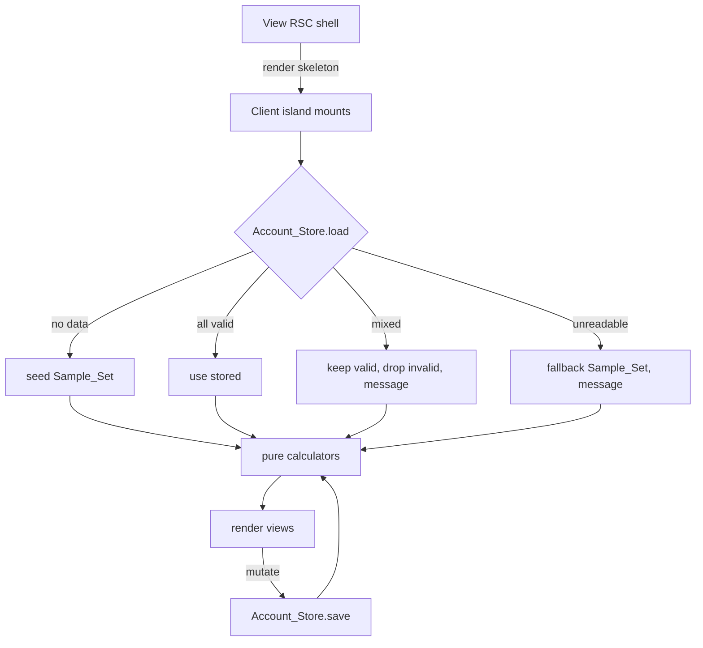
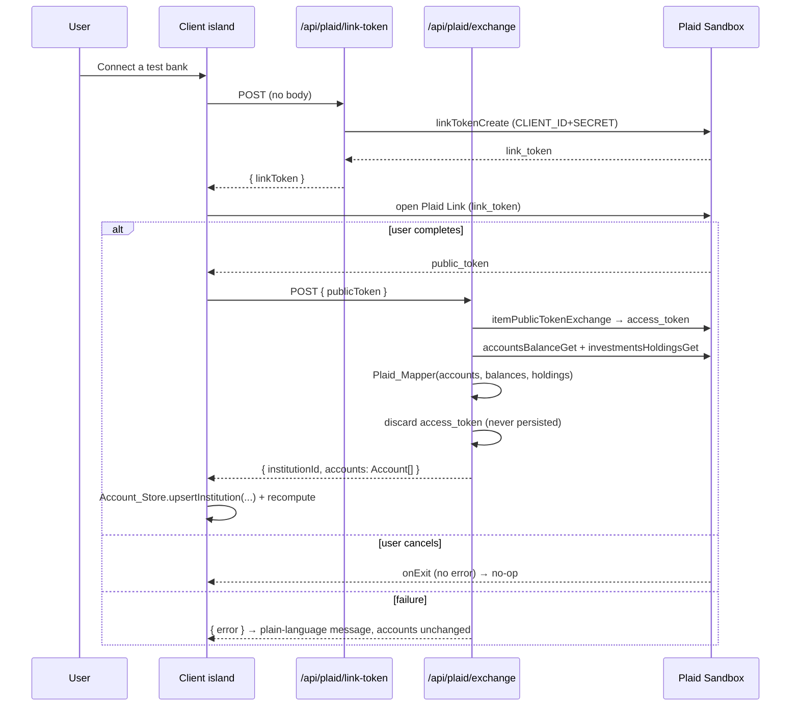

# Design Document

## Overview

This feature turns the read-only sample dashboard into the user's own. Every account gains a
`Source` (Sample, Manual, or Connected) and a stable `id`, and the runtime source of truth moves
from the static `data/accounts.json` import to a browser-persisted `Account_Store` backed by
`localStorage`. The three existing views (dashboard, projection, buy-vs-rent) compute from that
stored set rather than the file, so edits, additions, deletions, and Plaid connections flow into
the same net-worth, allocation, projection, and buy-vs-rent math with no view branching on Source.

Three new pieces of logic are introduced, each isolated behind the project's separation rules:

- **`Account_Store`** (`lib/accounts/accountStore.ts`): a browser-only, defensive persistence
  module that mirrors the existing `Target_Store`. It seeds the canonical Sample_Set on a first
  visit, loads valid stored accounts otherwise, and performs **partial recovery** — keeping the
  valid accounts, dropping only the unreadable ones, and reporting how many were lost.
- **`Plaid_Mapper`** (`lib/plaid/mapper.ts`): a pure, unit-tested function that converts Plaid
  accounts, balances, and holdings into our `Account` model, applying documented asset-class rules
  and guaranteeing every non-liability account it returns has a split summing to exactly 100.
- **Account editing validation** (`lib/accounts/accountValidation.ts`): a pure per-account
  validator for inline editor feedback, distinct from the batch `validateAccounts` load guard.

Server-only Plaid calls live in `app/api/plaid/` routes; the Plaid secret is read only there and is
never sent to the browser. Plaid Link runs client-side with a short-lived `Link_Token` the server
mints; tokens are never persisted. Only the mapped `Connected_Account`s reach the `Account_Store`.

This spec supersedes two Spec 1 decisions: account editing and persistent storage, both previously
out of scope, are now in scope (browser-only). Plaid Production, server-side storage, webhooks,
transactions, and holding-level editing remain out of scope.

### Research Notes

- **Plaid Sandbox custom users.** Plaid Sandbox supports custom test users defined as JSON, letting
  us fix account type, subtype, balances, and holdings so each institution returns a realistic,
  deterministic set — see [Plaid Sandbox: Customize test data](https://plaid.com/docs/sandbox/user-custom/)
  and the [plaid/sandbox-custom-users](https://github.com/plaid/sandbox-custom-users) reference
  repo. We ship two configs (one per institution) so multi-institution aggregation is demonstrated
  by connecting twice (R15). Content was rephrased for compliance with licensing restrictions.
- **Plaid Link + token flow.** Link is the mandatory client-side connection component; the server
  mints a `Link_Token`, Link returns a `Public_Token`, and the server exchanges it for an
  `Access_Token` ([Plaid Link overview](https://plaid.com/docs/link/)). We fetch accounts,
  balances, and investment holdings within the same server request, map them, and discard the
  `Access_Token` without persisting it (R8). The `plaid` Node SDK is server-only; the browser uses
  `react-plaid-link` with only the `Link_Token`.
- **Investments / holdings.** Holdings and their securities (type/subtype, name, market value) come
  from the investments product ([Plaid Investments](https://plaid.com/docs/investments/add-to-app/)).
  These feed the `Plaid_Mapper`'s classification and split derivation (R10).

## Architecture

### Separation boundaries (enforced)

```
 Browser (client)                          Server (Next.js)
┌────────────────────────────┐            ┌──────────────────────────────────────┐
│ app/*/page.tsx (RSC shells) │            │ app/api/plaid/link-token/route.ts     │
│   └─ *Client.tsx islands    │  fetch →   │ app/api/plaid/exchange/route.ts       │
│        │                    │            │   reads PLAID_CLIENT_ID / PLAID_SECRET │
│        ├─ Account_Store ────┼─ localStorage │   └─ lib/plaid/client.ts (SDK)       │
│        │   (browser-only)   │            │        └─ lib/plaid/mapper.ts (PURE)   │
│        ├─ react-plaid-link  │            └──────────────────────────────────────┘
│        └─ lib/calculations/ │ (pure; imported by both client and server)
└────────────────────────────┘
```

- `lib/calculations/` imports nothing from `app/`, `components/`, `lib/fred/`, `lib/plaid/`, or
  `lib/accounts/`. Pure in, pure out.
- `lib/plaid/mapper.ts` is pure: it imports only `@/types/*`, performs no fetch, reads no clock and
  no `localStorage`, and imports nothing from `app/`, `components/`, or `lib/fred/` (R10.1).
- `lib/plaid/client.ts` (the SDK wrapper) is imported only by `app/api/plaid/` routes, never by
  components or pages — the same rule `lib/fred/client.ts` already follows.
- `Account_Store` (`lib/accounts/accountStore.ts`) is imported only by client code, never by the
  pure calculators, server components, or FRED modules (R7.7). It is the project's only account
  `localStorage` user, as `Target_Store` is for the target.

### Runtime data flow (per view)

Each view's RSC shell renders immediately with the Spec 1 loading skeleton. A client island mounts,
reads the `Account_Store` (seeding or partial-recovering as needed), runs the pure calculators on
the resulting accounts, and renders. Because `localStorage` is browser-only, the island seeds state
with `null`/loading on the server render and first paint — it never reads the static file or shows
sample numbers before load (R17.2, R17.3). Every subsequent mutation (edit/add/delete/connect/
disconnect) writes through the store and recomputes (R2.7, R6.5, R8.6, R9.x, R17.5).



### Plaid connection flow



## Components and Interfaces

### New pure modules (`lib/`)

#### `lib/accounts/accountValidation.ts` — per-account editor validation (R3)

Distinct from the batch `validateAccounts` guard. Validates a single in-progress editor entry and
returns a discriminated union consistent with the existing `TargetValidationResult` style.

```ts
export interface AccountInput {
  institution: string;      // raw
  accountName: string;      // raw
  accountType: string;      // raw; checked against the known set
  balance: string;          // raw string so blank / non-numeric is catchable
  split: { stocks: string; bonds: string; cash: string; other: string };
}

export type AccountFieldError =
  | 'institution' | 'accountName' | 'accountType' | 'balance'
  | 'stocks' | 'bonds' | 'cash' | 'other' | 'split-sum';

export type AccountValidationResult =
  | { ok: true; value: ValidatedAccountFields }
  | { ok: false; field: AccountFieldError; message: string };

export function validateAccountInput(input: AccountInput): AccountValidationResult;
```

Rules: non-empty institution ≤ 120 chars; `accountName` non-empty ≤ 120; `accountType` in the
known set; finite non-negative balance (R3.1). For non-liability types, each split value is a whole
number 0–100 and the four sum to exactly 100 (R3.2). For liability/mortgage types, no split-sum
requirement and the account contributes no asset-class value (R3.3). First offending field is
reported in a fixed order so the editor shows one inline message at a time (R3.4–R3.6).

#### `lib/plaid/mapper.ts` — Plaid → Account model (R10)

```ts
export interface PlaidSecurity {
  securityId: string;
  type?: string | null;        // e.g. 'equity', 'fixed income', 'cash', 'derivative'
  subtype?: string | null;
  name?: string | null;
}
export interface PlaidHolding {
  accountId: string;
  securityId: string;
  institutionValue: number;    // market value of the holding
}
export interface PlaidAccountRaw {
  accountId: string;
  name: string;
  mask: string | null;
  type: string;                // 'depository' | 'investment' | 'loan' | 'credit' | ...
  subtype: string | null;      // 'checking' | 'savings' | 'mortgage' | '401k' | ...
  balanceCurrent: number;
}
export interface PlaidMapperInput {
  institution: string;
  accounts: PlaidAccountRaw[];
  securities: PlaidSecurity[];
  holdings: PlaidHolding[];
  idFor: (accountId: string) => string;   // injected id factory — keeps the mapper pure (no RNG/clock)
}

export function mapPlaidToAccounts(input: PlaidMapperInput): Account[];
export function classifyHolding(security: PlaidSecurity): AssetClass;   // exported for direct testing
```

Classification order (R10.4, R10.5), documented in the module:
1. **By Plaid security type/subtype** when present: equity → `stocks`; fixed-income/bond types →
   `bonds`; cash/money-market types → `cash`.
2. **Else by security name** (case-insensitive): contains `bond`, `treasury`, `fixed income`,
   `aggregate`, or `municipal` → `bonds`; contains `money market` → `cash`; any other ETF/mutual
   fund → `stocks`.
3. **Else `other`** only for a truly unclassifiable security (derivative, crypto, or unknown with
   no usable type or name).

Mapping rules: depository (checking/savings) → matching `AccountType`, full balance to `cash`
(R10.2); loan `mortgage` subtype → `mortgage` type, other loans and credit cards → `liability`,
amount owed stored positive (R10.3); investment with holdings → derive split by summing each
holding's `institutionValue` into its classified class, converting to whole-number percentages that
sum to exactly 100 via the same largest-remainder method the Allocation_Calculator uses (R10.6,
R10.8); investment with no holdings → full balance to `other` and `allocationNeedsInput: true`
(R10.7).

### New server routes (`app/api/plaid/`)

- **`link-token/route.ts`** — `POST`. Reads `PLAID_CLIENT_ID`/`PLAID_SECRET` (only here), calls the
  SDK `linkTokenCreate`, returns `{ linkToken }`. On failure returns a non-2xx error body (R8.2,
  R13.2). `export const dynamic = 'force-dynamic'`.
- **`exchange/route.ts`** — `POST { publicToken }`. Exchanges for an `Access_Token`, fetches
  accounts/balances/holdings, calls `mapPlaidToAccounts`, discards the token, returns
  `{ institutionId, institutionName, accounts }`. Never writes any token anywhere (R8.3–R8.5).
- **`status/route.ts`** (or a field on the shell's server data) — reports `Plaid_Keys_Present` by
  checking env on the server, so the client can hide/disable the entry point without seeing secrets
  (R14.1, R14.4).
- **Link flow configuration R18.** The link-token route opens Plaid Link straight to the institution picker: it sends only a fixed demo client_user_id with no phone number, email, or returning-user hint, so Link skips the returning-user phone step. Products stay Investments, country US, language en. Because Plaid can also enable that step via account-level Link customization a token cannot override, the connect screen documents the one-time Dashboard toggle to disable it for Sandbox and names the exact Sandbox sign-in plus a test-phone fallback. Presentation-only: no change to token handling, the Plaid_Mapper, or any calculation. Covers R18.1 through R18.6.

### New / extended client modules

- **`lib/accounts/accountStore.ts`** — the `Account_Store` (see Data Models + Correctness
  Properties). Public surface: `loadAccounts(): AccountLoadResult`, `saveAccounts(accounts)`,
  `startFresh()`, `restoreSampleData()`, `upsertConnectedInstitution(institutionId, accounts)`,
  `disconnectInstitution(institutionId)`. All reads defensive, never throw (R7.6).
- **`lib/accounts/sampleSet.ts`** — the canonical `Sample_Set`: the Spec 1 accounts upgraded with
  `id`, `source: 'Sample'`, and (for the stored shape) derived fields. Pure data + a builder.
- **`components/ui/AccountEditor.tsx`**, `AccountRow.tsx`, `SourceBadge.tsx`, `SourceMixSummary.tsx`,
  `PlaidConnectButton.tsx` (wraps `react-plaid-link`), `RentAssumptionNote.tsx`,
  `StorageRecoveryBanner.tsx`. These are UI; they import pure calculators/validators for formatting
  but never fetch and never import the Plaid SDK.
- **`components/layout/*Client.tsx`** — each island gains the store-load lifecycle (seed/recover),
  replacing the server-file-derived props path from Spec 1 (R17).

### Store ↔ view contract

Islands call `loadAccounts()` on mount, run `validateAccounts` + the pure calculators on the result,
and subscribe to store mutations by re-reading after each action. The store returns both the usable
accounts and any recovery message so the island can render `StorageRecoveryBanner` (R7.4, R7.5).

## Data Models

### Extended `Account` (types/accounts.ts)

The Spec 1 `Account` is extended with identity, source, and source-specific fields. `AccountType`
gains `mortgage`. Existing calculators treat both `liability` and `mortgage` as liabilities.

```ts
export type AccountType =
  | 'brokerage' | 'IRA' | 'Roth IRA' | '401(k)'
  | 'HYSA' | 'checking' | 'liability'
  | 'mortgage';                                   // NEW (R10.3, R11)

export type AccountSource = 'Sample' | 'Manual' | 'Connected';

export interface Account {
  id: string;                     // stable, unique within the store, persists across edits (R1.2)
  source: AccountSource;          // exactly one of Sample/Manual/Connected (R1.1)
  institution: string;
  accountName: string;            // NEW: shown in editor and used in Account_Match_Key
  accountType: AccountType;
  balance: number;                // liabilities store amount owed as positive
  assetClassBreakdown: AssetClassBreakdown;
  lastUpdatedDaysAgo: number;

  // Source-specific, all optional so the one Account shape serves every Source:
  updatedByYouDate?: string;      // ISO date; Manual only (R5.2, R5.3)
  mask?: string | null;           // Connected only; part of Account_Match_Key (R4.5)
  plaidInstitutionId?: string;    // Connected only; groups a Plaid_Item's accounts (R9)
  splitOverride?: AssetClassBreakdown;  // Connected only; "adjusted by you" (R4.2, R4.3)
  allocationNeedsInput?: boolean; // Connected investment with no holdings (R10.7, R13.3)
}
```

`LIABILITY_TYPES = ['liability', 'mortgage']` becomes the single source of truth for the liability
check, replacing the Spec 1 `accountType === 'liability'` comparisons in the calculators (R12).

### Account_Match_Key (R4.5)

```ts
export interface AccountMatchKey {
  institution: string;
  accountName: string;
  mask: string | null;
}
// Equality is case-insensitive on institution+accountName, exact on mask.
```

Used on reconnect to carry a `Split_Override` onto the matching refreshed account; a prior override
with no match is dropped and reported (R4.6).

### Stored shape and load result

```ts
export const ACCOUNTS_STORAGE_KEY = 'jwh.accounts';   // mirrors Target_Store's 'jwh.targetAllocation'

export interface AccountLoadResult {
  accounts: Account[];                 // the usable set (seeded, loaded, or partially recovered)
  recovery:
    | { kind: 'ok' }
    | { kind: 'seeded' }               // nothing stored → Sample_Set (R7.2)
    | { kind: 'partial'; dropped: number }   // some invalid dropped (R7.4)
    | { kind: 'fallback' };            // unreadable → Sample_Set restored (R7.5)
}
```

The stored value is the JSON array of `Account`. On load the store parses defensively, validates
each element with the existing per-account shape checks, and produces one of the four `recovery`
outcomes. Writes serialize the full set on every change (R7.1).

### Source_Mix_Summary (R1.4)

```ts
export interface SourceMixEntry { source: AccountSource; count: number; assetSharePct: number; }
export type SourceMixSummary = SourceMixEntry[];   // one entry per Source present
```

Derived in a pure helper (`lib/calculations/sourceMix.ts`) from the accounts' asset balances
(liabilities excluded from the share basis, consistent with allocation).

### Plaid Sandbox test users (R15)

Two JSON configs under `data/plaid-sandbox-users/` in Plaid's current custom-user format:
institution A with a HYSA + a student loan (liability); institution B with a 401(k) + a brokerage;
combined, no mortgage. The connect screen documents which credentials to use per institution.

## Correctness Properties

*A property is a characteristic or behavior that should hold true across all valid executions of a
system — essentially, a formal statement about what the system should do. Properties serve as the
bridge between human-readable specifications and machine-verifiable correctness guarantees.*

The pure modules introduced by this spec — the `Plaid_Mapper`, the per-account validator, the
`Account_Store` set operations and load/recovery logic, and the freshness/net-worth rules extended
for the new Source and `mortgage` type — are all pure functions with universal invariants, so
property-based testing applies to them. UI affordances, Plaid SDK wiring, token handling, static
JSON configs, and documentation edits are not property-tested (see Testing Strategy).

### Property 1: Calculations are Source-invariant

*For any* valid set of accounts and *any* reassignment of each account's `source` to any of Sample,
Manual, or Connected, `computeNetWorth`, `computeClassTotals`, and `computeActualAllocation` return
equal results — no calculation branches on Source.

**Validates: Requirements 1.5**

### Property 2: Editing a Sample_Account makes it Manual

*For any* Sample_Account and *any* valid edit to any of its fields, the saved account has
`source === 'Manual'` and keeps its stable `id`.

**Validates: Requirements 2.5, 1.2**

### Property 3: Delete-then-undo is a round trip

*For any* account set and *any* member of it, deleting that account and then invoking undo restores
the identical set (same accounts, same order, same ids).

**Validates: Requirements 2.3**

### Property 4: Required-field validation accepts exactly the valid inputs

*For any* account input, `validateAccountInput` returns `ok: true` iff the institution is non-empty
and ≤ 120 chars, the account name is non-empty and ≤ 120 chars, the account type is in the known
set, and the balance is finite and non-negative; otherwise it returns `ok: false` naming the first
offending field.

**Validates: Requirements 3.1**

### Property 5: Split validation accepts exactly the sum-to-100 splits

*For any* four candidate split values on a non-liability account (including a Connected account's
`Split_Override`), `validateAccountInput` accepts the split iff every value is a whole number in
[0, 100] and the four sum to exactly 100; otherwise it rejects on a split field or `split-sum`.

**Validates: Requirements 3.2, 4.2**

### Property 6: Liabilities are exempt from the split-sum rule

*For any* input whose account type is `liability` or `mortgage`, `validateAccountInput` never
rejects on the split-sum rule regardless of the split values.

**Validates: Requirements 3.3**

### Property 7: Applying a Split_Override keeps Source and toggles the label

*For any* Connected_Account, applying a valid `Split_Override` leaves `source === 'Connected'` and
sets `splitOverride`; the "adjusted by you" label is shown iff `splitOverride` is present.

**Validates: Requirements 4.3, 4.4**

### Property 8: Reconnect carries matched overrides and drops unmatched ones

*For any* prior set of overridden Connected_Accounts and *any* freshly fetched set, merging the
reconnect carries each prior `Split_Override` onto the fresh account whose `Account_Match_Key`
(case-insensitive institution + account name, exact mask) equals the prior account's, and omits —
recording in a `dropped` list — every prior override whose key matches no fresh account.

**Validates: Requirements 4.5, 4.6**

### Property 9: Manual_Accounts are never stale

*For any* Manual_Account and *any* `lastUpdatedDaysAgo`, the freshness result is not stale.

**Validates: Requirements 5.1**

### Property 10: Sample and Connected freshness follows the three-day rule

*For any* Sample_Account, or Connected_Account with freshness information, the account is stale iff
`lastUpdatedDaysAgo` exceeds the three-day Stale_Rule threshold.

**Validates: Requirements 5.4**

### Property 11: Start fresh removes exactly the Sample_Accounts

*For any* account set, `startFresh` returns exactly the non-Sample accounts of the input, unchanged
and in their original order.

**Validates: Requirements 6.1, 6.2**

### Property 12: Restore sample data preserves others, adds one Sample_Set, and is idempotent

*For any* account set, `restoreSampleData` preserves every non-Sample account unchanged and yields
exactly one copy of the canonical Sample_Set with no duplicates; applying it twice equals applying
it once.

**Validates: Requirements 6.3, 6.4**

### Property 13: Save-then-load round trip

*For any* valid set of accounts, `saveAccounts` followed by `loadAccounts` returns an equal set with
`recovery.kind === 'ok'`.

**Validates: Requirements 7.1, 7.3**

### Property 14: Partial recovery keeps the valid and counts the dropped

*For any* stored array mixing valid `Account` objects with arbitrary invalid entries in any order,
`loadAccounts` returns exactly the valid accounts in their original relative order and reports
`recovery.dropped` equal to the number of invalid entries (when at least one valid account remains).

**Validates: Requirements 7.4**

### Property 15: Loading is total and never throws

*For any* string placed in storage (including non-JSON, wrong-typed JSON, and arbitrary bytes), and
in an environment with no usable `localStorage`, `loadAccounts` returns a result and never throws.

**Validates: Requirements 7.5, 7.6**

### Property 16: Disconnect removes only the target institution's Connected_Accounts

*For any* account set and *any* `institutionId`, `disconnectInstitution` removes exactly the
Connected_Accounts whose `plaidInstitutionId` equals that id and preserves every other account
unchanged and in order.

**Validates: Requirements 9.3**

### Property 17: Reconnect replaces rather than duplicates an institution

*For any* store and *any* freshly fetched account set for an `institutionId`,
`upsertConnectedInstitution` leaves exactly the fresh set for that id (no stale duplicates for it)
while carrying over `Split_Override`s per Property 8 and preserving all other accounts.

**Validates: Requirements 9.4**

### Property 18: Depository accounts map to all-cash

*For any* Plaid depository account (checking or savings), the mapped account's split is `cash: 100`
(others 0) and its `AccountType` matches the depository-subtype mapping.

**Validates: Requirements 10.2**

### Property 19: Loan and credit accounts map to liabilities with a positive balance

*For any* Plaid loan or credit account, the mapped account's type is `mortgage` iff the subtype is a
mortgage loan and `liability` otherwise, and its balance (amount owed) is stored as a non-negative
number.

**Validates: Requirements 10.3**

### Property 20: Holding classification respects the documented precedence

*For any* Plaid security, `classifyHolding` applies the rules in order: an explicit equity /
fixed-income / cash type or subtype decides the class before any name heuristic; otherwise a name
containing "bond", "treasury", "fixed income", "aggregate", or "municipal" maps to bonds, a name
containing "money market" maps to cash, any other ETF or mutual fund maps to stocks; and only a
security with no usable type or name (derivative, crypto, or unknown) maps to other.

**Validates: Requirements 10.4, 10.5**

### Property 21: Holdings split is proportional to per-class market value

*For any* investment account with holdings of positive market value, the derived split assigns each
asset class a share proportional to the sum of its holdings' market values (the class with the
larger summed value gets the larger-or-equal percentage).

**Validates: Requirements 10.6**

### Property 22: A holdingless investment account flags for input

*For any* investment account that reports no holdings, the mapped account's split is `other: 100`
and `allocationNeedsInput === true`.

**Validates: Requirements 10.7, 13.3**

### Property 23: Every mapped non-liability account sums to exactly 100

*For any* `PlaidMapperInput`, every non-liability account returned by `mapPlaidToAccounts` has whole-
number split values with `stocks + bonds + cash + other === 100`.

**Validates: Requirements 10.8**

### Property 24: The rent note appears exactly when a mortgage is present

*For any* account set, the Decision_View shows the Rent_Assumption_Note iff at least one account has
type `mortgage`.

**Validates: Requirements 11.1, 11.4**

### Property 25: Mortgage presence does not change the buy-vs-rent result

*For any* buy-vs-rent inputs, the computed comparison is identical whether or not a Mortgage_Account
is present among the accounts.

**Validates: Requirements 11.5**

### Property 26: Net worth subtracts every liability; allocation excludes them

*For any* account set, `computeNetWorth` subtracts the positive balance of every `liability` and
`mortgage` account of any Source from total assets, and `computeClassTotals` (and thus allocation)
excludes every `liability` and `mortgage` account from asset-class totals.

**Validates: Requirements 12.1, 12.2, 12.3, 3.3**

## Error Handling

- **Account editor validation (R3).** `validateAccountInput` returns a typed `{ ok: false, field,
  message }` rather than throwing; the editor renders the plain-language message beside the offending
  field, keeps Save disabled, and clears the message when the field becomes valid. Liability and
  mortgage types bypass the split-sum rule.
- **Storage load (R7.4–R7.6).** Every read is wrapped so SSR (no `window`), disabled/unavailable
  `localStorage`, non-JSON content, wrong-typed JSON, or a malformed array resolves to a safe
  `AccountLoadResult` without throwing. Mixed content triggers partial recovery (keep valid, drop
  invalid, report `dropped`); unparseable or all-invalid content falls back to the Sample_Set with a
  `fallback` message. Writes are best-effort and swallow quota/private-mode failures, mirroring
  `Target_Store`.
- **Plaid flow (R13).** Link `onExit` with no error is a no-op that returns to the prior state (no
  accounts added, no error shown). Any failure of link-token creation, token exchange, or data
  fetching returns a non-2xx body from the route; the island shows a plain-language connection-error
  message and leaves existing accounts unchanged. A successful connection that returns accounts but
  no holdings still adds the mappable accounts and flags affected investment accounts "Allocation
  needs your input". An in-progress indicator is shown while connecting, and partial/unmapped data is
  never presented as final.
- **Plaid keys absent (R14).** `Plaid_Keys_Present` is computed on the server; when false the entry
  point is hidden or disabled with a plain-language explanation, and every non-Plaid feature stays
  fully functional. The Plaid secret never appears in any client-reachable payload.
- **Reconnect override loss (R4.6).** When a prior `Split_Override` matches no freshly fetched
  account, the merge drops it and surfaces a plain-language message naming that the adjustment could
  no longer be applied.

## Testing Strategy

### Dual approach

- **Property tests** cover the pure universal invariants (Properties 1–26) with the project's Vitest
  setup plus **fast-check** as the property-based testing library. We do not implement PBT from
  scratch. Each property test runs a **minimum of 100 iterations** and is tagged with a comment
  referencing its design property in the format:
  `// Feature: account-sources-editable-and-plaid, Property {number}: {property_text}`.
  Each correctness property is implemented by a **single** property-based test.
- **Unit (example) tests** cover concrete anchors and edge cases: the five named `classifyHolding`
  examples (Vanguard Total Bond Market ETF → bonds; iShares Core U.S. Aggregate Bond ETF → bonds;
  Vanguard Total Stock Market ETF → stocks; SPDR S&P 500 ETF Trust → stocks; a cash/money-market
  holding → cash; a derivative/crypto/typeless holding → other) (R10.5); the load state-machine
  branches (empty → seeded; valid → ok; unparseable/all-invalid → fallback) (R7.2, R7.5); and the
  editor's inline message placement, Save gating, and message clearing (R3.4–R3.6).

Per the structure rules, the pure modules' tests live in `lib/calculations/__tests__/` (the extended
calculators and `sourceMix`), `lib/accounts/__tests__/` (validator and store set-ops/load logic),
and `lib/plaid/__tests__/` (mapper). The testing scope for this spec is unit tests for the
Plaid-to-model mapping, account-editing validation, and storage load-and-fallback logic, which the
properties above and these unit tests cover.

### Non-PBT areas

- **Plaid SDK wiring and token handling (R8.2–R8.5, R13.2, R14.4, R17.1).** Route tests with a
  **mocked** Plaid client verify tokens are exchanged server-side, holdings are fetched, the mapper
  is invoked, and no token (or secret) appears in any response or persisted value. These use 1–3
  representative cases, not property tests, because behavior does not vary meaningfully with input
  and the calls are effectful.
- **UI behavior (R3.4–R3.6, R11.2–R11.3, R13.1, R13.4, R14.1–R14.3, R17.2–R17.3).** Component tests
  for inline validation feedback, the non-blocking rent note and its session dismissal, Link cancel
  and in-progress states, the keys-absent hide/disable path, and the loading skeleton (no sample
  numbers before load).
- **Static configuration (R15).** Schema/example tests validate the two Sandbox custom-user JSON
  files' shape and contents (institution A: HYSA + student loan; institution B: 401(k) + brokerage;
  combined: no mortgage) against Plaid's current custom-user format.
- **Import-boundary checks (R7.7, R10.1).** A static check asserts that no file in
  `lib/calculations/`, `lib/fred/`, or any server component imports `lib/accounts/accountStore.ts`,
  and that `lib/plaid/mapper.ts` imports only from `@/types/*`.
- **Documentation (R9.x module docs, R10.9, R16).** The mapper module documents its classification
  rules; the product scope steering doc is updated to move real bank linking and persistence into
  scope while keeping Plaid Production, server-side storage, webhooks, transactions, and
  holding-level editing out of scope. Verified by review, not automated tests.
