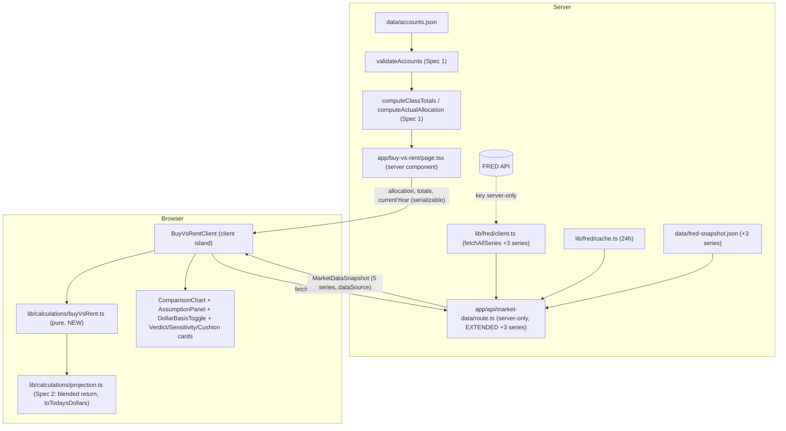
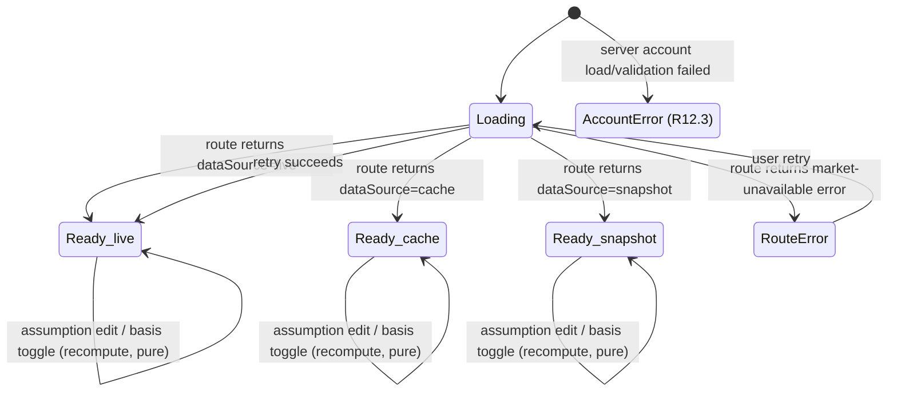

# Design Document

## Overview

The Buy-vs-Rent Scenario Tester (Spec 3) is the product hero feature. It answers one question: given
the user's current allocation, is the user likely to be wealthier in ten years buying a home now or
renting and investing the money not spent on a home? The view compares the user's projected net worth
at year 10 under a **Buy_Path** (a fixed-rate amortizing mortgage, home equity, ownership costs, a
year-10 sale) and a **Rent_Path** (continuing to rent while the un-spent down payment stays invested),
with the money saved by the cheaper path each month invested at the same expected return Spec 2 already
models. It reports a year-by-year chart of both paths, the breakeven year, a plain-language verdict with
a home-appreciation tipping point, base/optimistic/pessimistic ranges, a nominal-vs-today's-dollars
toggle, and the one or two assumptions the result is most sensitive to.

This spec **reuses and extends** the two completed specs rather than adding anything parallel:

- **Spec 1 (consolidated-net-worth-view)** supplies the starting position. `validateAccounts`,
  `computeClassTotals`, and `computeActualAllocation` in `lib/calculations/allocation.ts` turn
  `data/accounts.json` into the per-class dollar `ClassTotals` (the **Starting_Assets**) and the
  `AllocationResult` (the **Current_Allocation**). No change to Spec 1 code is required.
- **Spec 2 (long-term-wealth-projection)** supplies the return engine and the market-data path.
  `deriveReturnModel` + `computeBlendedReturn` in `lib/calculations/projection.ts` give the
  **Investment_Return** from the Current_Allocation and the market-derived `ReturnModel`. The
  `ScenarioMultipliers` pattern (optimistic 1.5, pessimistic 0.5, base 1.0), the `DollarBasis`
  (`'nominal' | 'today'`) and `toTodaysDollars` discounting, the server-only `Market_Data_Route`
  (`app/api/market-data/route.ts` + the pure `resolveMarketData`), the `lib/fred/{client,cache,types}.ts`
  modules, and `data/fred-snapshot.json` are all reused. This spec **extends** the market-data path with
  three new FRED series: `MORTGAGE30US`, `CSUSHPINSA`, and `CUSR0000SEHA`.

The new work is one pure calculator (`lib/calculations/buyVsRent.ts`), new shared types, the three-series
market-data extension across the shared FRED modules, and the view (`app/buy-vs-rent/page.tsx` + a client
island). The design follows the Spec 2 patterns exactly:

- The pure calculator is inputs-in/numbers-out: it imports nothing from `app/`, `components/`, or
  `lib/fred/`, performs no fetch, reads no `localStorage`, and never reads the clock. The current year and
  every market/assumption value are passed in by the caller, so it runs identically on the server (first
  paint) and in the client island (recompute on edit).
- The server component loads and validates accounts and derives `currentYear` from `new Date()` at the
  boundary; a client island fetches `/api/market-data`, owns the editable assumptions, the Dollar_Basis
  toggle, and the state machine, and calls the pure calculator on every edit.
- Formatting flows through `lib/format.ts` (`formatCurrency`); all user-facing copy is centralized in a
  new `lib/buyVsRentMessages.ts` mirroring `lib/projectionMessages.ts`; the chart carries a
  programmatically associated text alternative with the SVG hidden from assistive technology.

### Requirements-to-Design Map

| Req | Summary | Where satisfied |
|---|---|---|
| R1 | Buy_Path: fixed-rate amortizing mortgage, zero-rate case, non-increasing balance to exactly zero at term, appreciating Home_Value, year-N Buy_Net_Worth incl. year-10 selling cost | `amortize` / `homeValueAtYear` / `computeBuyPath` in `buyVsRent.ts` |
| R2 | Rent_Path: start = Starting_Assets, monthly rent/ownership costs, symmetric Monthly_Difference reinvestment, annual Investment_Return, Investment_Return = Spec 2 Blended_Expected_Return | `computeRentPath` / `computeBuyPath` side-investment term / `deriveInvestmentReturn` in `buyVsRent.ts` |
| R3 | Down-payment drawdown (cash first, then pro-rata), Post_Purchase_Allocation, Cash_Cushion vs Cushion_Threshold with non-color cue, over-budget message | `computeDrawdown` in `buyVsRent.ts`; `AllocationShiftCard` / `CushionCard` (island) |
| R4 | 11 year-0..10 values per path, year-0 starting positions, year-10 call-outs, whole-dollar tabular-nums, unavailable message | `computeComparison` in `buyVsRent.ts`; `ComparisonSummary`; `BuyVsRentMessages` |
| R5 | Base/optimistic/pessimistic bands per path; Rent varies return, Buy varies return + appreciation; band chart with non-color path cue; year-10 range; monotonic ordering | `buildBands` in `buyVsRent.ts`; `ComparisonChart` band |
| R6 | Breakeven_Year = first year 1..10 base-band Buy ≥ Rent, or none | `findBreakevenYear` in `buyVsRent.ts`; `VerdictCard` |
| R7 | Verdict: which path wins at year 10 + dollar size; Appreciation_Tipping_Point in −20%..+20%; one-decimal rate; Dollar_Basis-consistent | `computeVerdict` + `findTippingPoint` in `buyVsRent.ts`; `VerdictCard` |
| R8 | Sensitivity_Ranking: fixed relative perturbation per assumption, rank by \|Δ year-10 difference\|, deterministic tie-break, report top 1–2 | `rankSensitivity` in `buyVsRent.ts`; `SensitivityCard` |
| R9 | Every assumption visible/sourced/editable; market source labels + as-of dates; recompute on valid edit; inline validation retaining last valid; reset; bound enforcement | `AssumptionPanel` (island) + `validateAssumption` helpers; `buyVsRentMessages` |
| R10 | Nominal ↔ today's-dollars toggle; persistent text label; today's-dollars discounting via Spec 2 Inflation_Rate; inflation-unavailable fallback | `DollarBasisToggle` (reused) + `toTodaysDollars` (Spec 2); `BuyVsRentClient` |
| R11 | Three new series served through the Spec 2 route + 24h cache + snapshot fallback; key never exposed; defaults derived from the series; snapshot/cache signaling | Extended `lib/fred/{client,types}.ts`, `route.ts`, `resolveMarketData.ts`, `data/fred-snapshot.json`; `MarketDataBanner` (reused) |
| R12 | Loading/error states; plain language; retry; both-fail | `BuyVsRentClient` state machine + `buyVsRentMessages` + `BuyVsRentErrorBoundary` |
| R13 | Accessible chart: text alternative, hover/focus tooltip within 200 ms, keyboard, SVG hidden, unavailable message exposed | `ComparisonChart` |
| R14 | Unit tests for amortization, loan balance, year-10 net worths, reinvestment, breakeven, sensitivity + tipping point only | `lib/calculations/__tests__/buyVsRent.test.ts` (see Testing Strategy) |

### Steering note

The `tech.md` FRED series table already lists `MORTGAGE30US`, `CSUSHPINSA`, and `CUSR0000SEHA`, so no
steering update is needed for this spec. (`DTB3` was the Spec 2 addition; it is already tracked by that
spec's design note.) This spec's market-data extension is purely additive to the shared modules.

## Architecture

### Layering and the server/client split

The scenario view has the same two independently-sourced inputs as the Spec 2 projection, resolved the
same two ways:

1. **Account data** — the static `data/accounts.json`, validated by Spec 1's `validateAccounts` and
   reduced to `ClassTotals` (the **Starting_Assets**) and `AllocationResult` (the **Current_Allocation**)
   by `computeClassTotals` / `computeActualAllocation`. Resolved on the **server** in
   `app/buy-vs-rent/page.tsx`, exactly as the dashboard and projection pages do.
2. **Market data** — now five series (the Spec 2 `CPIAUCSL`/`DGS10`/`DTB3` plus the three added here),
   resolved through the server-only `Market_Data_Route`, which applies the live → cache → snapshot
   fallback. The FRED key stays on the server; the browser only ever sees a resolved `MarketDataSnapshot`.

The `BuyVsRent_Calculator` is **pure** and runs wherever it is called. Because it reads no clock and no
storage, the server can compute a first comparison for initial paint and the client island recomputes on
every assumption edit, both deterministically — the caller passes in `currentYear`, the market snapshot,
the Starting_Assets, the Current_Allocation, and all editable assumptions.



As in Spec 2, account data is resolved synchronously at render time on the server (a module import),
while the market data is fetched by the client island from the server-only route. This keeps the FRED key
off the client and lets the market-data loading/error states live entirely in the island without blocking
the page shell.

### Market-data + comparison state machine

The island drives a single state for the comparison area. Account data resolves on the server, so by the
time the island mounts either accounts are present or the page has already routed to the account-error
state; the island's own state machine tracks the market-data lifecycle plus the derived comparison
readiness.



- **Ready_live / Ready_cache / Ready_snapshot** differ only in the banner/note shown (R11.5, R11.6) and
  the `dataSource` carried on the snapshot; the comparison renders identically.
- **RouteError** is the snapshot-unreadable or route-failure case (R11.2 unreadable → R12.2): no chart, no
  figures, assumptions retained, retry offered (R12.2, R12.4).
- **AccountError** (R12.3) is decided on the server before the island renders; if both the account data
  and the market data fail, the account-unavailable message wins (mirrors Spec 2's both-fail rule).
- **Over-budget purchase** (R3.6) is a sub-state of a Ready state, not a machine error: market data and
  accounts resolved, but the current Down_Payment + Closing_Costs exceed Starting_Assets. The view shows a
  plain-language message in place of a (negative) Cash_Cushion while still rendering the comparison.
- **Inflation-unavailable** (R10.6) is likewise a Ready sub-state: the basis stays on nominal and a
  message is shown; it does not block the comparison.

## Components and Interfaces

### Extended shared FRED modules (server-only)

These modules are **shared with Spec 2** and are extended, not replaced. Each touch point is called out so
implementation changes the same five-series set everywhere consistently.

**`types/market.ts`** — extend the series union and the resolved snapshot (see Data Models). This is the
one file both the server FRED path and the browser view import, so the three new series ids and the three
new resolved fields are added here first.

**`lib/fred/types.ts`** — extend `RawSeriesValues` with the three new raw values (`mortgageRate`,
`homePriceIndex`, `rentIndex`). `FredObservation`, `FredObservationsResponse`, `RawSeriesValue`,
`FetchFailureReason`, `FredFetchResult`, and `CacheEntry` are unchanged in shape — the cache stores
`RawSeriesValues`, so widening that interface automatically carries the new series through the cache.

**`lib/fred/client.ts`** — `fetchAllSeries` currently fetches three series via `Promise.all` and
short-circuits on the first failure. Extend the `Promise.all` to six `fetchSeries` calls
(`CPIAUCSL`, `DGS10`, `DTB3`, `MORTGAGE30US`, `CSUSHPINSA`, `CUSR0000SEHA`) sharing the one
`AbortSignal.timeout` budget (R11.1, R11.2), add the three new `ok` guards (so a missing new series maps
to `missing-series` with no partial values, R11.2), and include the three new values in the returned
`RawSeriesValues`. `fetchSeries` itself needs no change — it is already series-id-generic. The API key is
still passed in by the route, never read here.

**`app/api/market-data/route.ts`** — extend `readSnapshot()` to `parseSeries` the three new snapshot
entries (`mortgageRate` → `MORTGAGE30US`, `homePriceIndex` → `CSUSHPINSA`, `rentIndex` → `CUSR0000SEHA`)
and require all six series (any gap → `null` → market-unavailable, R11.2). `parseSeries` is unchanged —
it already validates one entry against an expected series id. No other change: the handler still reads the
key only here and never writes it into a response (R11.1).

**`app/api/market-data/resolveMarketData.ts`** — extend only `toSnapshot` to map the three new raw values
onto the three new `MarketDataSnapshot` fields. The live → cache → snapshot → error cascade is unchanged:
the same 24-hour caching, the same `DataSource` resolution, and the same "never serve a partial set" rule
now cover all six series (R11.1, R11.2).

**`data/fred-snapshot.json`** — add the three new entries with recent values and as-of dates so the view
functions with no API key configured (R11.3). See Data Models for the extended shape.

### `lib/calculations/buyVsRent.ts` (pure, NEW)

Mirrors the `projection.ts` house style: a file-level JSDoc stating the purity contract, shared constants
(the fixed 10-year `COMPARISON_HORIZON`, default `MORTGAGE_TERM_YEARS = 30`, default `MAINTENANCE_RATE = 1`,
default `CUSHION_MONTHS = 6`, the `SENSITIVITY_STEP` relative perturbation, the `TIPPING_POINT_RANGE`
of ±20, and the reused `ASSET_CLASS_KEYS`), exhaustive per-class iteration, and per-function JSDoc tagged
with the requirement clauses it satisfies. It imports only from `@/types/accounts` (for `AssetClass`,
`ClassTotals`), `@/types/market` (for `MarketDataSnapshot`, `ReturnModel`, `ScenarioMultipliers`), and the
pure Spec 2 `projection.ts` (for `deriveReturnModel` / `computeBlendedReturn`) — nothing from `app/`,
`components/`, or `lib/fred/`.

```ts
// --- Mortgage amortization (R1.1–R1.5) ---

/** Monthly principal-and-interest payment that fully amortizes the loan (R1.2, R1.3). */
export function monthlyPayment(
  loanAmount: number,
  annualRatePercent: number, // Mortgage_Rate; 0 → loanAmount / nPayments (R1.3)
  termYears: number,
): number;

/**
 * Month-by-month amortization schedule (R1.4, R1.5). Returns one entry per month for
 * termYears * 12 months: each carries that month's interest, principal, and the end-of-month
 * Loan_Balance. The balance is non-increasing and never negative, and is clamped so the final
 * month ends at exactly zero (R1.5).
 */
export function amortize(
  loanAmount: number,
  annualRatePercent: number,
  termYears: number,
): AmortizationMonth[];

// --- Down-payment drawdown + allocation shift (R3.1–R3.4) ---

/**
 * Fund Down_Payment + Closing_Costs from Starting_Assets: cash first, then pro-rata across
 * stocks/bonds/other by dollar weight (R3.1). Returns the reduced per-class balances, the
 * Post_Purchase_Allocation percentages (R3.2), the Cash_Cushion (R3.4), and an over-budget flag
 * set when the funded sum exceeds the Starting_Assets total (R3.6).
 */
export function computeDrawdown(
  startingAssets: ClassTotals,
  fundedAmount: number, // Down_Payment + Closing_Costs
): DrawdownResult;

// --- Investment return (R2.7) ---

/** Investment_Return = Spec 2 Blended_Expected_Return from Current_Allocation + Return_Model (R2.7). */
export function deriveInvestmentReturn(
  currentAllocationFractions: Record<AssetClass, number>, // AllocationResult.percentages / 100
  market: MarketDataSnapshot,
  returnAssumptions: ReturnAssumptions, // Spec 2 equityRiskPremium / otherReturn
): number; // percent per year

// --- Single-band path computation (R1.6, R1.7, R2.1–R2.6, R4.1, R4.2) ---

/**
 * Compute one band's Buy_Path and Rent_Path net-worth series (11 values each, years 0..10).
 * Advances the amortization and the two monthly cost streams month by month, applies the
 * symmetric Monthly_Difference reinvestment to whichever path is cheaper that month (R2.4), grows
 * every invested balance by the (possibly scenario-scaled) return once per completed year (R2.5),
 * and books home equity (Home_Value − Loan_Balance) with the year-10 selling cost applied once
 * (R1.7). `appreciationRatePercent` and `annualReturnPercent` are passed per band so buildBands can
 * vary them (R5.2, R5.3).
 */
export function computePaths(
  inputs: PathInputs, // starting assets total, assumptions, annualReturnPercent, appreciationRatePercent
): PathResult; // { buy: number[]; rent: number[] } — 11 values each

// --- Scenario bands (R5.1–R5.3, R5.6) ---

/**
 * Build base/optimistic/pessimistic bands for BOTH paths (R5.1). The Rent_Path varies the
 * Investment_Return by the Scenario_Multiplier (R5.2); the Buy_Path varies BOTH the side-investment
 * return by the multiplier AND the Home_Appreciation_Rate up (optimistic) / down (pessimistic) from
 * base (R5.3). Under the stated multiplier/appreciation bounds, optimistic ≥ base ≥ pessimistic for
 * every year and both paths (R5.6).
 */
export function buildBands(
  assumptions: BuyVsRentAssumptions,
  startingAssetsTotal: number,
  baseReturnPercent: number,
  multipliers: ScenarioMultipliers,
): ComparisonBands; // { buy/rent: { base/optimistic/pessimistic: number[] } }

// --- Breakeven (R6.1, R6.2) ---

/** First year N in 1..10 with base-band Buy ≥ Rent, or null when none in the horizon (R6.1, R6.2). */
export function findBreakevenYear(baseBuy: number[], baseRent: number[]): number | null;

// --- Verdict + tipping point (R7.1, R7.2) ---

/** Which path leads at year 10 (base band) and the absolute dollar size of the gap (R7.1). */
export function computeVerdict(baseBuy: number[], baseRent: number[]): VerdictFigures;

/**
 * Appreciation_Tipping_Point: the Home_Appreciation_Rate at which base-band Buy equals base-band
 * Rent at year 10, holding all else fixed, found numerically within −20%..+20% (R7.2, R7.3).
 * Returns null when the outcome does not flip across that range (R7.4).
 */
export function findTippingPoint(
  assumptions: BuyVsRentAssumptions,
  startingAssetsTotal: number,
  baseReturnPercent: number,
): number | null; // percent per year, or null

// --- Sensitivity (R8.1–R8.5) ---

/**
 * Perturb each editable assumption by the SAME fixed relative step (R8.5), one at a time, recompute
 * the year-10 base-band difference, and rank assumptions by |Δ difference| descending (R8.1, R8.2),
 * breaking ties by a fixed assumption ordering so the ranking is deterministic (R8.4).
 */
export function rankSensitivity(
  assumptions: BuyVsRentAssumptions,
  startingAssetsTotal: number,
  baseReturnPercent: number,
): SensitivityEntry[];

// --- Orchestrator ---

/**
 * Compose the full comparison from resolved inputs (R4.1): the three bands per path, the drawdown
 * and cushion (R3), the breakeven (R6), the verdict + tipping point (R7), and the sensitivity
 * ranking (R8). Returns nominal values; the caller applies toTodaysDollars for display (R10).
 */
export function computeComparison(input: ComparisonInput): ComparisonResult;
```

Key math decisions (all requirement-tagged in JSDoc):

- **Amortization (R1.2–R1.5):** monthly rate `i = Mortgage_Rate/100/12`, `n = termYears*12`. Payment
  `M = P·i·(1+i)^n / ((1+i)^n − 1)`; when `i == 0`, `M = P/n` (R1.3). Each month: `interest = balance·i`,
  `principal = M − interest`, `balance -= principal`. The final month's principal is clamped to the
  remaining balance so the schedule ends at exactly zero and the balance is never negative (R1.5). The
  year-N `Loan_Balance` is the end-of-month balance at month `N*12`.
- **Home value (R1.6):** `Home_Value(N) = Home_Price·(1 + appreciation/100)^N` for N = 0..10.
- **Buy net worth (R1.7, R4.2):** `Home_Value(N) − Loan_Balance(N) + BuySideInvestment(N)`, minus the
  year-10 selling cost `Home_Value(10)·SellingCostPercent/100` applied only at N = 10. Year 0 equals
  `Home_Price − Loan_Amount − Closing_Costs + year-0 side investment` (R4.2).
- **Rent net worth (R2.1, R2.6, R4.2):** a single invested balance seeded at the Starting_Assets total
  (the renter spends neither Down_Payment nor Closing_Costs, R2.1), grown by the Investment_Return once
  per year with reinvested Monthly_Difference added; no home equity, no mortgage (R2.6). Year 0 equals the
  Starting_Assets total (R4.2).
- **Symmetric reinvestment (R2.2–R2.4):** each month compute `Ownership_Cost_Monthly` (payment + monthly
  shares of property tax `rate·HomeValue`, homeowners insurance, maintenance `rate·HomeValue`, and HOA)
  and `Rent_Cost_Monthly` (current rent + 1/12 renters insurance, rent grown once per completed year).
  The `Monthly_Difference` is added to the invested side of whichever path is cheaper that month — the
  Buy_Path accumulates a side investment when owning is cheaper, the Rent_Path when renting is cheaper.
- **Annual compounding of invested balances (R2.5):** the Investment_Return is applied once per completed
  year to each running invested balance; within a year the twelve monthly contributions accumulate and
  then grow at the year boundary. This matches the Spec 2 annual-compounding convention.
- **Investment_Return (R2.7):** `deriveInvestmentReturn` calls the Spec 2 `deriveReturnModel(market,
  returnAssumptions)` then `computeBlendedReturn(currentAllocationFractions, returnModel)`. The scenario
  bands scale this rate by the `ScenarioMultipliers` exactly as Spec 2's `buildScenarios` does.
- **Bands (R5.1–R5.3, R5.6):** base uses the blended return and the base appreciation rate; optimistic
  uses `return·optimisticMultiplier` and a higher appreciation rate; pessimistic uses
  `return·pessimisticMultiplier` and a lower appreciation rate. Because each path's net worth is monotonic
  non-decreasing in both the return and the appreciation rate (for non-negative balances and a
  non-negative home value), optimistic ≥ base ≥ pessimistic holds for every year whenever the optimistic
  multiplier ≥ 1.0, pessimistic ≤ 1.0, optimistic appreciation ≥ base, and pessimistic appreciation ≤ base
  (R5.6).
- **Tipping point (R7.2, R7.3):** `findTippingPoint` evaluates the year-10 base-band difference
  `Buy(10) − Rent(10)` as a function of the Home_Appreciation_Rate and locates the root by bisection over
  −20%..+20% after a sign-change scan; returns null when no sign change exists across the range (R7.4).
  Only the appreciation rate is varied; all other assumptions are held fixed.
- **Sensitivity (R8.1–R8.5):** for each editable assumption in a fixed order, multiply its current value by
  `(1 + SENSITIVITY_STEP)` (the same relative step for every assumption, R8.5), recompute `Buy(10) −
  Rent(10)` under the base band, and record `|perturbed difference − current difference|`. Rank
  descending; on an exact tie, the earlier assumption in the fixed order wins (R8.4), so the ranking is
  stable for identical inputs. The view reports the top one or two (R8.3).

### Reused Spec 2 modules (unchanged)

- **`lib/calculations/projection.ts`** — `deriveReturnModel` + `computeBlendedReturn` provide the
  Investment_Return; `toTodaysDollars` converts each nominal path series to today's dollars for display
  (R10.3); `DEFAULT_SCENARIO_MULTIPLIERS` and `ScenarioMultipliers` drive the bands. No change.
- **`app/api/market-data/*`, `lib/fred/*`, `data/fred-snapshot.json`** — extended for the three new series
  as described above; the fallback/caching behavior is reused verbatim.

### UI components (`components/`)

- **`components/charts/ComparisonChart.tsx`** (`'use client'`, NEW) — Recharts band chart drawing both the
  Buy_Path and Rent_Path bands (each bounded by its pessimistic/optimistic series with its base series as a
  line inside), distinguished by a **text label or shape cue** (e.g. solid vs dashed base line plus a
  labeled legend), never color alone (R5.4). It carries a programmatically associated `sr-only` text
  alternative listing the year-10 Buy and Rent values for base, optimistic, and pessimistic bands plus the
  Breakeven_Year, with tabular numerals (R13.1), using the `AllocationPie` / `ProjectionChart`
  `<figure aria-labelledby>` + `sr-only` pattern; the SVG is `aria-hidden` (R13.5). Tooltips appear on
  **hover and keyboard focus within 200 ms**, showing the year, the path, and the net-worth dollar value
  for the focused point, and dismiss on blur/leave (R13.2, R13.3). When the comparison is unavailable it
  renders no graphic and the plain-language unavailable message is exposed to assistive tech (R13.6).
- **`components/ui/AssumptionPanel.tsx`** (reused + extended, or a buy-vs-rent variant) — the
  `Assumption_Panel`. Lists every editable assumption with its current value and text label (R9.1):
  Home_Price, Down_Payment_Percent, Mortgage_Rate, Mortgage_Term_Years, Property_Tax_Rate,
  Homeowners_Insurance, Maintenance_Rate, HOA_Monthly, Closing_Costs, Selling_Cost_Percent,
  Home_Appreciation_Rate, Current_Rent_Monthly, Rent_Growth_Rate, Renters_Insurance, the cushion-months
  multiple, the Optimistic_Multiplier, and the Pessimistic_Multiplier. Market-derived assumptions show a
  source label naming the `Market_Series` and its as-of date (R9.2): Mortgage_Rate cites `MORTGAGE30US`,
  Home_Appreciation_Rate cites `CSUSHPINSA`, Rent_Growth_Rate cites `CUSR0000SEHA`. Inline validation
  messages appear adjacent to the offending input; invalid edits leave the last valid comparison unchanged
  and retain the previously accepted value (R9.4). A reset control restores market-derived/documented
  defaults and clears messages (R9.5). Bounds are enforced per R9.6.
- **`components/ui/DollarBasisToggle.tsx`** (reused from Spec 2) — the keyboard-operable two-state control
  (nominal default / today's dollars) with a persistent text label distinguishable without color (R10.1,
  R10.4). Switching updates values, chart, and verdict in place within the 1-second budget (R10.5).
- **`components/ui/MarketDataBanner.tsx`** (reused from Spec 2) — the `role="note"` banner with a text +
  symbol cue (never color alone) shown when `dataSource` is `snapshot` (fallback banner with the snapshot
  last-updated date, R11.5) or `cache` (plain-language "last updated" note that does not present the data
  as live, R11.6). Hidden when `dataSource` is `live`.
- **`components/ui/ComparisonSummary.tsx`** (new card, mirrors the Spec 2 summary) — renders the year-10
  Buy and Rent call-out figures, each labeled with its path, as whole-dollar tabular numerals (R4.3, R4.4),
  and each path's year-10 outcome as a pessimistic-to-optimistic **range** rather than a single point
  (R5.5).
- **`VerdictCard`, `SensitivityCard`, `AllocationShiftCard`, `CushionCard`** (new `components/ui/` cards)
  — the plain-language Verdict with the tipping-point sentence in the active Dollar_Basis (R7.1, R7.3–R7.6);
  the top one or two sensitive assumptions by labeled name (R8.3); the Current vs Post_Purchase_Allocation
  side by side (R3.3); and the Cash_Cushion vs Cushion_Threshold with a text/shape status cue plus the
  over-budget message (R3.5, R3.6). Each is its own card per the calm card-based ui-style.
- **`components/ui/BuyVsRentEmptyState.tsx` / `BuyVsRentErrorState.tsx`** — plain-language unavailable
  states (R4.5, R12), mirroring Spec 1's `EmptyState` / `ErrorState` and Spec 2's projection states.

### View and island

- **`app/buy-vs-rent/page.tsx`** (server component, NEW) — loads and validates `accounts.json` with Spec
  1's helpers, computes `totals` (Starting_Assets) and `allocation` (Current_Allocation), derives
  `currentYear` from `new Date()` at the boundary, and routes: account-load/validation failure →
  account-unavailable state (R12.3, both-fail rule); otherwise it renders the shell and the client island,
  passing serializable props (`allocation`, `totals`, `currentYear`). It does **not** fetch market data —
  the island does, so the FRED key path and the market loading/error states stay client-side against the
  server-only route.
- **`components/layout/BuyVsRentClient.tsx`** (`'use client'`, the island, NEW) — owns: fetching
  `/api/market-data`, the market/comparison state machine, the editable assumptions (seeded with
  market-derived defaults once the snapshot resolves — Mortgage_Rate from `MORTGAGE30US`,
  Home_Appreciation_Rate from `CSUSHPINSA`, Rent_Growth_Rate from `CUSR0000SEHA`, R11.4), the Dollar_Basis
  toggle, and calling the pure `buyVsRent.ts` `computeComparison` on every change, then
  `toTodaysDollars` for display when the basis is `today` (R10.3). The recompute is pure and synchronous,
  so every edit and the basis switch update within the 1-second budget without reloading (R9.3, R10.5).
  Wrapped by a **`BuyVsRentErrorBoundary`** (same pattern as `DashboardErrorBoundary` /
  `ProjectionErrorBoundary`) so an unexpected fault falls back to the plain-language unavailable copy.
- **`components/layout/BuyVsRentErrorBoundary.tsx`** (NEW) — mirrors the existing error boundaries; renders
  the route-error copy, never a stack trace or blank screen.

## Data Models

### `types/market.ts` (extended — shared with Spec 2)

The series union and the resolved snapshot grow by three. Existing fields are unchanged, so Spec 2 keeps
working; the three new resolved fields are what this spec reads.

```ts
/** The FRED series the app uses. Spec 3 adds MORTGAGE30US, CSUSHPINSA, CUSR0000SEHA. */
export type MarketSeriesId =
  | 'CPIAUCSL'
  | 'DGS10'
  | 'DTB3'
  | 'MORTGAGE30US'   // 30-year fixed mortgage rate → default Mortgage_Rate (R11.4)
  | 'CSUSHPINSA'     // Case-Shiller home price index → default Home_Appreciation_Rate (R11.4)
  | 'CUSR0000SEHA';  // CPI rent of primary residence → default Rent_Growth_Rate (R11.4)

/** The resolved set served to the view (R11.1). Spec 2 fields unchanged; three new fields added. */
export interface MarketDataSnapshot {
  cpi: MarketSeriesValue;          // CPIAUCSL (drives Inflation_Rate)
  tenYear: MarketSeriesValue;      // DGS10 (bonds anchor)
  threeMonth: MarketSeriesValue;   // DTB3 (cash anchor)
  mortgageRate: MarketSeriesValue; // MORTGAGE30US (percent per year)
  homePriceIndex: MarketSeriesValue; // CSUSHPINSA (index level)
  rentIndex: MarketSeriesValue;    // CUSR0000SEHA (index level)
  dataSource: DataSource;
}
```

`MarketSeriesValue`, `DataSource`, `MarketDataError`, `ReturnAssumptions`, `ClassReturn`, `ReturnModel`,
`ScenarioMultipliers`, `DollarBasis`, and `ProjectedPoint` are reused from Spec 2 unchanged.

### `lib/fred/types.ts` (extended)

```ts
/** Resolved raw series from a successful fetch, keyed to match MarketDataSnapshot. */
export interface RawSeriesValues {
  cpi: RawSeriesValue;            // CPIAUCSL
  tenYear: RawSeriesValue;        // DGS10
  threeMonth: RawSeriesValue;     // DTB3
  mortgageRate: RawSeriesValue;   // MORTGAGE30US  (new)
  homePriceIndex: RawSeriesValue; // CSUSHPINSA    (new)
  rentIndex: RawSeriesValue;      // CUSR0000SEHA  (new)
}
```

`CacheEntry` stores `RawSeriesValues`, so widening this interface carries the three new series through the
24-hour cache with no other change.

### `data/fred-snapshot.json` (extended)

```json
{
  "cpi":            { "seriesId": "CPIAUCSL",     "value": 315.6,   "asOf": "2026-09-01" },
  "tenYear":        { "seriesId": "DGS10",        "value": 4.1,     "asOf": "2026-10-14" },
  "threeMonth":     { "seriesId": "DTB3",         "value": 4.8,     "asOf": "2026-10-14" },
  "mortgageRate":   { "seriesId": "MORTGAGE30US", "value": 6.3,     "asOf": "2026-10-14" },
  "homePriceIndex": { "seriesId": "CSUSHPINSA",   "value": 322.4,   "asOf": "2026-08-01" },
  "rentIndex":      { "seriesId": "CUSR0000SEHA", "value": 420.1,   "asOf": "2026-09-01" }
}
```

The default `Home_Appreciation_Rate` and `Rent_Growth_Rate` are derived in the calculator from the
CSUSHPINSA and CUSR0000SEHA index levels (a documented year-over-year growth derivation that the snapshot
supports with a recent level; the exact derivation is fixed in the calculator and shown as a sourced
default), and the default `Mortgage_Rate` is the `MORTGAGE30US` value directly (R11.4).

### `types/market.ts` additions for the calculator (new, shared)

All serializable (primitives and plain objects), so they cross the server→client boundary and are safe as
island props and test fixtures.

```ts
/** The fixed comparison horizon in whole years (R-glossary Comparison_Horizon). */
export const COMPARISON_HORIZON = 10;

/** Every editable assumption behind the comparison (R9.1). All values are numbers. */
export interface BuyVsRentAssumptions {
  homePrice: number;             // dollars (R9.6: ≥ 0)
  downPaymentPercent: number;    // 0–100 (R9.6)
  mortgageRatePercent: number;   // 0–20, default MORTGAGE30US (R9.6, R11.4)
  mortgageTermYears: number;     // default 30
  propertyTaxRatePercent: number;
  homeownersInsurance: number;   // annual dollars
  maintenanceRatePercent: number;// default 1
  hoaMonthly: number;            // default 0
  closingCosts: number;          // dollars
  sellingCostPercent: number;
  homeAppreciationRatePercent: number; // −20..+20, default from CSUSHPINSA (R9.6, R11.4)
  currentRentMonthly: number;    // dollars
  rentGrowthRatePercent: number; // −20..+20, default from CUSR0000SEHA (R9.6, R11.4)
  rentersInsurance: number;      // annual dollars
  cushionMonths: number;         // default 6 (R3.5)
  multipliers: ScenarioMultipliers; // optimistic 1.5 / pessimistic 0.5 default
}

/** One month of the amortization schedule (R1.4, R1.5). */
export interface AmortizationMonth {
  monthIndex: number;   // 1-based
  interest: number;
  principal: number;
  balance: number;      // end-of-month Loan_Balance; non-increasing, ≥ 0, exactly 0 at term end
}

/** Result of the down-payment drawdown (R3.1–R3.4, R3.6). */
export interface DrawdownResult {
  postPurchaseDollars: ClassTotals;         // reduced per-class balances
  postPurchaseAllocation: Record<AssetClass, number>; // percentages (R3.2)
  cashCushion: number;                      // remaining cash (R3.4)
  overBudget: boolean;                      // funded sum exceeded Starting_Assets total (R3.6)
}

/** One band's 11-value series for both paths (years 0..10). */
export interface PathResult {
  buy: number[];   // length 11
  rent: number[];  // length 11
}

/** The three bands for one path. */
export interface PathBands {
  base: number[];
  optimistic: number[];
  pessimistic: number[];
}

/** Both paths' bands (R5.1). */
export interface ComparisonBands {
  buy: PathBands;
  rent: PathBands;
}

/** Verdict figures (R7.1). */
export interface VerdictFigures {
  leader: 'buy' | 'rent' | 'tie';
  year10Difference: number; // absolute dollar size of the base-band year-10 gap
}

/** One ranked sensitivity entry (R8). `key` identifies the editable assumption; `label` is its name. */
export interface SensitivityEntry {
  key: keyof BuyVsRentAssumptions;
  label: string;
  year10DifferenceDelta: number; // |Δ year-10 base-band difference| under the fixed relative step
}

/** Everything the orchestrator needs (resolved at the boundary / in the island). */
export interface ComparisonInput {
  startingAssets: ClassTotals;                 // Spec 1 ClassTotals (Starting_Assets)
  currentAllocationFractions: Record<AssetClass, number>; // AllocationResult.percentages / 100
  market: MarketDataSnapshot;
  returnAssumptions: ReturnAssumptions;        // Spec 2 equityRiskPremium / otherReturn
  assumptions: BuyVsRentAssumptions;
}

/** The full nominal comparison the view renders (R4.1). Caller applies toTodaysDollars for display. */
export interface ComparisonResult {
  bands: ComparisonBands;                 // 11 values per band per path
  drawdown: DrawdownResult;               // allocation shift + cushion (R3)
  cushionThreshold: number;               // cushionMonths × first-year Ownership_Cost_Monthly (R3.5)
  breakevenYear: number | null;           // R6
  verdict: VerdictFigures;                // R7.1
  tippingPointPercent: number | null;     // R7.2–R7.4
  sensitivity: SensitivityEntry[];        // ranked, R8
  investmentReturnPercent: number;        // the base Investment_Return used (R2.7)
}
```

`ReturnAssumptions` is the Spec 2 type. A dedicated calculator types file (e.g. `types/buyVsRent.ts`) may
host these instead of `types/market.ts` to keep the market file focused; either placement is acceptable as
long as the types stay shared and serializable. The `PathInputs` referenced by `computePaths` is an
internal shape assembled by `buildBands` from a `BuyVsRentAssumptions` plus a per-band return and
appreciation rate.

## Error Handling

All user-facing copy is plain language with no technical terms — no data-format names, no route/endpoint
names, no numeric status codes, no file names (R12.5) — and lives in a centralized
`lib/buyVsRentMessages.ts` mirroring `lib/projectionMessages.ts`, so a future copy audit has a single
source. The reused `DollarBasisToggle`, `MarketDataBanner`, and the Spec 2 inflation-unavailable pattern
carry their copy conventions over.

### Market-data + comparison state table (R3.6, R4.5, R9.4, R10.6, R11.5, R11.6, R12)

| State | Trigger | What renders | Plain-language copy | Req |
|---|---|---|---|---|
| Loading | market request in flight | loading indication in place of figures + chart; no values shown | "Loading your comparison…" | R12.1 |
| Ready (live) | route `dataSource=live` | full comparison; no banner | — | R11.1 |
| Ready (cache) | route `dataSource=cache` | full comparison + "last updated" note, not presented as live | "Market data last updated Oct 14, 2026." | R11.6 |
| Ready (snapshot fallback) | route `dataSource=snapshot` | full comparison + visible fallback banner with snapshot date | "Using saved market data from Oct 14, 2026. Live data isn't available right now." | R11.5 |
| Route error | route returns market-unavailable (incl. snapshot unreadable) | no figures, no chart; assumptions retained; retry offered | "We can't show your comparison right now. Try again in a moment." | R12.2, R12.4 |
| Account error | server account load/validation failed | no figures, no chart | "We couldn't load your accounts, so there's nothing to compare yet." | R12.3 |
| Both fail | account data AND market data fail | account-unavailable message wins | (same as Account error) | R12.3 |
| Over-budget purchase | Down_Payment + Closing_Costs > Starting_Assets total | comparison still renders; cushion area shows a message, no negative cushion | "Buying this home would cost more than your available assets." | R3.6 |
| Inflation unavailable | today's-dollars selected but no Inflation_Rate | stay on nominal; message | "We couldn't adjust for inflation, so values are shown in future dollars." | R10.6 |
| Assumption validation | non-finite or out-of-range edit | inline message by the input; last valid comparison unchanged; previous value retained | e.g. "Enter a number from 0 to 20." | R9.4 |

The `BuyVsRentErrorBoundary` catches unexpected faults and renders the same route-error copy, never a
stack trace or blank screen. Assumption inputs are preserved across a market-data error and across an
invalid edit so a retry or correction does not discard the user's work (R9.4, R12.2, R12.4). When the
comparison is unavailable, the chart graphic is not rendered and the unavailable message is exposed to
assistive technology (R13.6).

## Testing Strategy

Per **Requirement 14**, testing for this spec is limited to **example-based Vitest unit tests** for the
`BuyVsRent_Calculator`. **Property-based testing is out of scope for this spec**, and so are component
tests and any other automated tests — task planning should mark nothing beyond the calculator unit-test
suite below. This is why the design carries **no Correctness Properties section**: Requirement 14 fixes the
testing scope to example-based unit tests of the calculation, breakeven, and sensitivity logic only. Each
test asserts an **exact** expected numeric value or outcome for a **fixed** input.

To keep the calculator unit-testable without a clock or network, every time-dependent and effectful input
is injected: the current year, the resolved `MarketDataSnapshot`, the Starting_Assets `ClassTotals`, the
Current_Allocation fractions, and all editable assumptions are passed in as plain values. This mirrors the
`resolveMarketData` injected-collaborators pattern — the pure calculator never reads the clock,
`process.env`, `localStorage`, or the network, so tests need no stubbing of time or I/O.

### `lib/calculations/__tests__/buyVsRent.test.ts`

Covers `lib/calculations/buyVsRent.ts`:

- **Monthly_Payment amortization, including the zero-interest case** (R14.1): assert the exact
  `monthlyPayment` for a fixed Loan_Amount, Mortgage_Rate, and term using the standard formula, and a
  separate fixed case where `Mortgage_Rate === 0` yields `loanAmount / (termYears*12)`.
- **Loan_Balance reaches exactly zero and is non-increasing** (R14.2): from a fixed
  `amortize(...)` schedule, assert the final month's `balance === 0` and that every month's balance is
  ≤ the previous month's balance (monotonic non-increasing, never negative).
- **Year-10 Buy_Net_Worth and Rent_Net_Worth** (R14.3): for one fixed input set, assert the exact year-10
  Buy value (home appreciation + remaining loan balance + the year-10 selling cost) and the exact year-10
  Rent value (initial invested amount + reinvested Monthly_Difference grown at the Investment_Return).
- **Symmetric reinvestment** (R14.4): one fixed case where owning is the cheaper monthly path, asserting
  the Buy_Path accumulated a side investment and the Rent_Path did not; and one fixed case where renting is
  cheaper, asserting the reverse.
- **Breakeven_Year detection** (R14.5): one fixed case with a breakeven within the horizon, asserting the
  exact year; one fixed case with none, asserting the no-breakeven result (`null`).
- **Sensitivity_Ranking and Appreciation_Tipping_Point** (R14.6): assert the exact ranked order of
  `rankSensitivity` for a fixed input (including the deterministic tie-break between two assumptions that
  produce the same magnitude of change), and assert the exact `findTippingPoint` rate for a fixed input
  (and `null` for a fixed input whose outcome does not flip across −20%..+20%).

Each assertion checks an exact expected value or outcome for a fixed input, with no randomized generation
(R14 scope). The three-series market-data extension is exercised through these calculator tests via a
fixed `MarketDataSnapshot` fixture carrying all six series; no separate automated tests are added for the
route or UI under this spec's testing scope.
