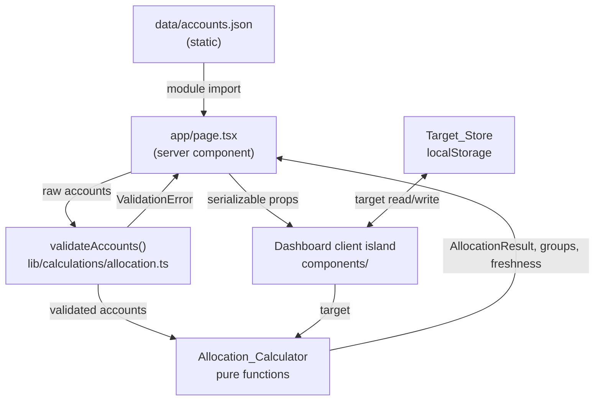
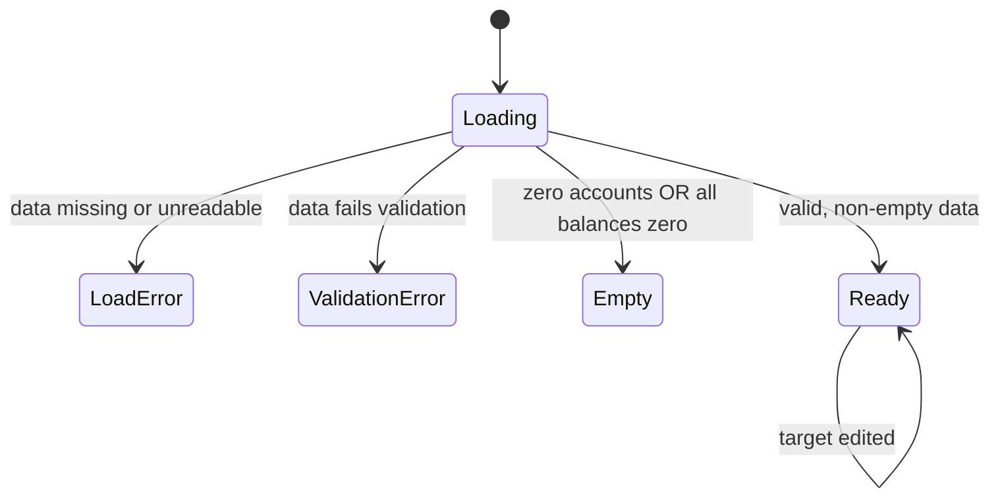

# Design Document

## Overview

The Consolidated Net Worth and Allocation View is the first of three specs for Jane Wealth Hub.
It reads simulated account data from a static JSON file, computes net worth and asset allocation
through a set of pure calculation functions, and renders a single dashboard showing total net
worth, an institution-grouped account breakdown, asset allocation across four classes, drift
against an editable target, and per-institution data freshness.

The design separates four concerns cleanly, following the project structure rules:

- **Data** (`data/accounts.json`) — static simulated accounts. No logic.
- **Calculation** (`lib/calculations/allocation.ts`) — pure functions: inputs in, numbers out.
  No UI imports, no fetch, no `localStorage`.
- **Types** (`types/accounts.ts`) — shared TypeScript interfaces used by both calculation and UI.
- **UI** (`app/page.tsx` plus `components/`) — loads the data, calls the calculator, and renders.

The guiding product principles shape every decision: **every assumption is visible, sourced, and
editable** (the target allocation is user-set and labeled when it is only an example), **ranges
over false precision** is deferred to Spec 2's projections but informs the one-decimal rounding
discipline here, and **plain language over jargon** drives the drift phrasing ("Stocks are 8
points above your target") and the error and empty-state copy.

This design maps to the nine requirements as follows:

| Requirement | Primary home in this design |
|---|---|
| R1 Net worth | `computeNetWorth` + net worth header component |
| R2 Institution breakdown | `computeInstitutionGroups` + institution list component |
| R3 Asset allocation | `computeClassTotals` + `computeActualAllocation` + `AllocationPie` |
| R4 Drift and on-track status | `computeDrift` + `classifyDrift` + `computeOnTrackStatus` + status banner |
| R5 Target allocation | `Target_Store` (localStorage) + target editor component |
| R6 Loading/error/empty states | Dashboard state machine + skeleton/error/empty components |
| R7 Data-shape validation | `validateAccounts` guarding all calculation entry points |
| R8 Data freshness | `computeFreshness` + freshness indicators |
| R9 Accessibility | Applied across all UI components (text alternatives, focus, contrast, non-color cues) |

## Architecture

### Data flow



### How the static data is loaded

`data/accounts.json` is imported as a module in the dashboard **server component**
(`app/page.tsx`). A server component is the right boundary because the data is static and
server-resident, nothing secret is involved, and it keeps the client bundle small. The raw import
is treated as `unknown` and passed through `validateAccounts` before any number is computed
(R7.1 requires validation to complete before computing).

Because the account data is a build-time module import rather than a network fetch, the "loading"
state (R6.1) in practice applies to the client island's first paint and the `localStorage` target
read, not to the JSON itself. The design still models a loading phase so the dashboard has a
single, uniform state machine and so the structure can later swap the static import for an async
source without reshaping the UI.

### How the pure calculator consumes it

The Allocation_Calculator never imports from `app/`, `components/`, or `lib/fred/`. It receives a
validated `Account[]` and a `TargetAllocation`, and returns plain data structures. All functions
are synchronous and deterministic. The calculator owns:

- validation (`validateAccounts`),
- aggregation (net worth, institution groups, class totals),
- allocation percentages with rounding discipline,
- drift and classification,
- freshness evaluation (given a "now" passed in, with each account's absolute `lastUpdated` date
  derived at the boundary from its `lastUpdatedDaysAgo` offset, so the function stays pure and
  testable and the sample data never decays over time).

### How the Dashboard renders

`app/page.tsx` (server) validates and computes, then renders the shell. A thin client component
(`components/layout/DashboardClient.tsx`) handles the interactive parts that require the browser:
reading and writing the target allocation via `Target_Store`, recomputing drift when the target
changes, and managing validation state for the target editor. Target-dependent math
(`computeDrift`, `classifyDrift`, `computeOnTrackStatus`) runs on the client whenever the user
edits the target; target-independent math (net worth, allocation, groups, freshness) is computed
once on the server and passed down as props.

Separation rule compliance:

- `lib/calculations/` imports nothing from `app/`, `components/`, or `lib/fred/`. The `now` value
  for freshness and the target allocation are **passed in** rather than read from globals.
- `components/` import pure functions from `lib/calculations/` for recomputation and formatting,
  but perform no data fetching.
- `Target_Store` (the only `localStorage` user) lives in `lib/` as a browser-only utility and is
  imported solely by the client island, never by the pure calculator.

### State machine for the dashboard

The dashboard renders exactly one of five states, which keeps R6's requirements unambiguous:



| State | Trigger | What renders |
|---|---|---|
| Loading | first paint / target read pending | skeleton (R6.1) |
| LoadError | import missing or unreadable (R6.2) | error message, no values |
| ValidationError | `validateAccounts` fails (R6.3) | error message, no values |
| Empty | zero accounts (R6.4) or all balances zero (R6.5) | net worth $0 + empty allocation message |
| Ready | valid, non-empty, nonzero | full dashboard |

## Components and Interfaces

### Module layout

```
app/
  page.tsx                         # server: import JSON, validate, compute, render shell
components/
  layout/
    DashboardShell.tsx             # page container, heading structure, landmarks
    DashboardClient.tsx            # client island: target state + drift recompute
  charts/
    AllocationPie.tsx              # Recharts pie wrapper + text alternative
  ui/
    NetWorthHeader.tsx             # assets / liabilities / net worth (R1)
    InstitutionList.tsx            # grouped accounts + subtotals + freshness (R2, R8)
    AllocationSection.tsx          # status banner + pie + per-class drift (R3, R4)
    TargetEditor.tsx               # four inputs, validation, side-by-side (R5, R9)
    OnTrackBanner.tsx              # overall status + largest-drift sentence (R4)
    FreshnessBadge.tsx             # "as of [date]" / "may be out of date" (R8)
    StaleDataBanner.tsx            # reusable banner primitive
    LoadingSkeleton.tsx            # R6.1
    ErrorState.tsx                 # R6.2, R6.3 (plain-language)
    EmptyState.tsx                 # R6.4, R6.5 (plain-language)
lib/
  calculations/
    allocation.ts                  # Allocation_Calculator (pure)
    __tests__/allocation.test.ts   # Vitest unit + property tests
  target/
    targetStore.ts                 # Target_Store (localStorage, browser-only)
types/
  accounts.ts                      # shared interfaces
data/
  accounts.json                    # static simulated accounts
```

### Allocation_Calculator public interface (`lib/calculations/allocation.ts`)

All functions are pure. `Result`-style returns are used for validation so no exceptions cross the
module boundary for expected failure modes.

```ts
// Validation — must run before any computation (R7.1)
export function validateAccounts(raw: unknown): ValidationResult;

// R1
export function computeNetWorth(accounts: Account[]): NetWorthResult;

// R2
export function computeInstitutionGroups(accounts: Account[]): InstitutionGroup[];

// R3
export function computeClassTotals(accounts: Account[]): ClassTotals;       // dollars per class
export function computeActualAllocation(totals: ClassTotals): AllocationResult; // percentages

// R4
export function computeDrift(
  actual: AllocationResult,
  totals: ClassTotals,
  target: TargetAllocation,
): DriftResult;
export function classifyDrift(driftPoints: number): DriftClassification; // on track | over | under
export function computeOnTrackStatus(drift: DriftResult): OnTrackStatus;

// R8 — `now` passed in to keep the function pure and testable. The boundary derives each
// account's absolute lastUpdated date from `now − lastUpdatedDaysAgo days` before calling in.
export function computeFreshness(accounts: Account[], now: Date): FreshnessResult;
```

### Target_Store interface (`lib/target/targetStore.ts`)

Browser-only. Separated from the pure calculator so `lib/calculations/` never touches
`localStorage`.

```ts
export const DEFAULT_TARGET: TargetAllocation; // 60/20/10/10, isExample: true (R5.7)

export function loadTarget(): TargetAllocation;          // returns DEFAULT_TARGET if none/invalid
export function saveTarget(target: TargetAllocation): void;
export function validateTarget(input: TargetInput): TargetValidationResult; // R5.2, R5.3
```

`loadTarget` validates what it reads; a malformed stored value falls back to `DEFAULT_TARGET`
labeled as an example rather than surfacing an error (R5.6, R5.7).

### UI composition

`app/page.tsx` renders `DashboardShell`, which lays out, in document order:

1. **NetWorthHeader** — three labeled values: total assets, total liabilities, net worth (R1.3).
   Negative net worth shows an explicit minus sign (R1.4). Values formatted as whole-dollar USD
   with thousands separators (R1.2).
2. **InstitutionList** — institution groups ordered by descending subtotal, alphabetical
   case-insensitive tie-break (R2.3); each group shows its subtotal, member accounts (institution
   name, type, balance), and a `FreshnessBadge` (R8).
3. **AllocationSection** — `OnTrackBanner` at the top (R4.6), then `AllocationPie` with its text
   alternative (R3.5, R9.1), then per-class rows showing actual %, target %, and drift in points
   and dollars with non-color cues (R4.2, R9.6).
4. **TargetEditor** — four integer inputs, inline validation, and the side-by-side actual-vs-target
   display (R5).

The `DashboardClient` island wraps the allocation and target portions because they recompute when
the target changes. The net worth header and institution list are static for a given data load and
can render on the server.

### Formatting helpers

Currency and percentage formatting live as small pure helpers in `lib/calculations/` (or a sibling
`lib/format.ts`) so components import formatting from `lib/`, never implement ad-hoc number
formatting, and never fetch. Whole-dollar USD uses `Intl.NumberFormat('en-US', { style:
'currency', currency: 'USD', maximumFractionDigits: 0 })`.

## Data Models

All shared interfaces live in `types/accounts.ts`.

### Core account model

```ts
/** The four asset-allocation buckets. */
export type AssetClass = 'stocks' | 'bonds' | 'cash' | 'other';

/** Account categories. `liability` is modeled as an account so the data shape stays uniform. */
export type AccountType =
  | 'brokerage'
  | 'IRA'
  | 'Roth IRA'
  | '401(k)'
  | 'HYSA'
  | 'checking'
  | 'liability';

/** Percentages for each class; for non-liability accounts these sum to 100 (within tolerance). */
export interface AssetClassBreakdown {
  stocks: number;
  bonds: number;
  cash: number;
  other: number;
}

export interface Account {
  institution: string;          // 1–120 chars, non-empty (R7.1)
  accountType: AccountType;
  /** Positive number. For liabilities this is the amount owed, stored positive and subtracted. */
  balance: number;              // finite (R7.3)
  assetClassBreakdown: AssetClassBreakdown;
  /**
   * Non-negative integer count of days before "now" that this account was last updated.
   * Stored relative (not as a fixed date) so the sample data never decays into looking stale
   * as real time passes. The absolute `lastUpdated` Date is derived at the boundary (server
   * component / loader) as `now − lastUpdatedDaysAgo days` and handed to the pure freshness
   * calculator; the JSON never stores an absolute date.
   */
  lastUpdatedDaysAgo: number;   // integer >= 0
}
```

Design note on `balance`: the requirements state liabilities are stored as **positive** numbers
and subtracted in net worth (R1.1). Keeping all balances positive makes institution subtotals and
validation uniform; the liability sign is applied only inside `computeNetWorth`.

Design note on `lastUpdatedDaysAgo`: freshness is stored **relative** rather than as a fixed ISO
date. If the sample data pinned absolute dates, every account would silently slide into "stale" as
calendar time passed. Storing a days-ago offset keeps the demo stable: the absolute `lastUpdated`
Date is computed at the boundary (the server component / loader) as the current date minus
`lastUpdatedDaysAgo` days, and only that derived date (together with `now`) crosses into the pure
calculator. The clock is never read inside the pure function.

### Calculation result models

```ts
export interface NetWorthResult {
  totalAssets: number;       // sum of non-liability balances
  totalLiabilities: number;  // sum of liability balances (positive)
  netWorth: number;          // totalAssets - totalLiabilities (may be negative, R1.4)
}

export interface InstitutionGroup {
  institution: string;
  subtotal: number;          // arithmetic sum of member balances (R2.5)
  accounts: Account[];       // members, preserving input order
}

/** Dollar value held in each class (liabilities excluded, R3.6). */
export type ClassTotals = Record<AssetClass, number>;

/** Actual allocation percentages, one decimal, summing to exactly 100 (R3.4) or all 0 (R3.3). */
export interface AllocationResult {
  percentages: Record<AssetClass, number>;
  classDollars: ClassTotals;  // the dollar basis behind each percentage
  totalAssetValue: number;    // sum across classes; 0 triggers the zero-total path
  isZeroTotal: boolean;       // true when totalAssetValue === 0 (R3.3)
}

export type DriftDirection = 'on track' | 'over' | 'under';

export interface DriftClassification {
  direction: DriftDirection;  // against ±5 On_Track_Threshold (R4.3–R4.5)
}

export interface ClassDrift {
  assetClass: AssetClass;
  driftPoints: number;        // actual% - target% (R4.1)
  driftDollars: number;       // actual$ - target-implied$ (R4.1)
  direction: DriftDirection;
}

export interface DriftResult {
  byClass: Record<AssetClass, ClassDrift>;
  offTargetCount: number;             // count of over/under (R4.8)
  largest: ClassDrift | null;         // largest absolute point drift when off target (R4.9)
}

export interface OnTrackStatus {
  onTrack: boolean;
  /** "On track" (R4.7) or "N of 4 asset classes off target" (R4.8). */
  label: string;
  /** Plain-language largest-drift sentence (R4.9), null when fully on track. */
  largestDriftSentence: string | null;
}
```

### Target model

```ts
export interface TargetAllocation {
  stocks: number;   // integer 0–100
  bonds: number;
  cash: number;
  other: number;
  /** True only for the unconfigured default (R5.7). Cleared once the user saves a valid target. */
  isExample: boolean;
}

/** Raw user entry before validation — strings so non-integer/blank input can be caught. */
export interface TargetInput {
  stocks: string;
  bonds: string;
  cash: string;
  other: string;
}
```

### Freshness model

```ts
export interface AccountFreshness {
  /** Absolute date derived at the boundary from `now − lastUpdatedDaysAgo days`. */
  lastUpdated: Date;
  isStale: boolean;   // more than Freshness_Threshold (3 days) before `now` (R8.3)
}

export interface InstitutionFreshness {
  institution: string;
  asOf: Date;         // most recent derived lastUpdated among the group's accounts (R8.1, R8.2)
  isStale: boolean;   // true if any member account is stale (R8.3)
}

export interface FreshnessResult {
  byInstitution: InstitutionFreshness[];
}
```

The `lastUpdated` dates here are the **derived** absolute dates. The boundary (server component /
loader) reads each account's `lastUpdatedDaysAgo` offset, subtracts that many days from the current
date, and passes the resulting dates (with `now`) into `computeFreshness`. The pure calculator
never sees the raw offsets or reads the clock; it compares already-resolved dates against the
`now` it is given. The "as of [date]" display and the >3-day stale flag are unchanged in meaning —
they are simply sourced from these days-ago-derived dates.

### Validation error model

```ts
export type ValidationErrorCode =
  | 'MISSING_FIELD'
  | 'INVALID_TYPE'
  | 'NON_FINITE_BALANCE'
  | 'INSTITUTION_LENGTH'
  | 'UNKNOWN_ACCOUNT_TYPE'
  | 'BREAKDOWN_SUM';

export interface ValidationError {
  code: ValidationErrorCode;
  accountIndex: number;       // which account (R7.2, R7.3, R7.5 identify the offending account)
  field?: string;             // offending field where applicable (R7.5)
  message: string;            // developer-facing detail; never shown verbatim to the user (R6.6)
}

export type ValidationResult =
  | { ok: true; accounts: Account[] }
  | { ok: false; errors: ValidationError[] };
```

The `message` on a `ValidationError` is developer-facing. The UI never shows it verbatim; the
`ErrorState` component renders its own plain-language copy (R6.6).

### Static data note

`data/accounts.json` holds a realistic mass-affluent spread across multiple institutions
(brokerage, IRA/Roth IRA, 401(k), HYSA, checking, plus at least one liability) so the breakdown,
ordering, and freshness paths all exercise real shapes. It contains data only — no logic.

The example liability is a **non-housing loan** (e.g., a student loan or car loan), not a mortgage.
The user in this product currently rents, and Spec 3 models the buy-vs-rent decision; shipping a
mortgage as a pre-existing liability would contradict that product story by implying the user
already owns a home. The liability sign convention is unchanged — it is stored as a **positive**
amount owed and subtracted inside `computeNetWorth`.

Freshness in the sample data is expressed with the relative `lastUpdatedDaysAgo` field so the demo
never decays over time (see the `lastUpdatedDaysAgo` design note above). Exactly one account is
stale — its `lastUpdatedDaysAgo` is about 5 (more than the 3-day threshold) — and every other
account is 0–2 days ago, so the dashboard reliably demonstrates both the fresh and the "may be out
of date" states regardless of when it is run.

## Correctness Properties

*A property is a characteristic or behavior that should hold true across all valid executions of a
system — essentially, a formal statement about what the system should do. Properties serve as the
bridge between human-readable specifications and machine-verifiable correctness guarantees.*

The Allocation_Calculator and Target_Store are pure, deterministic functions over a large input
space, which makes them well suited to property-based testing. The properties below were derived
from the acceptance criteria during prework, then consolidated to remove redundancy (for example,
the three drift-classification criteria collapse into one classification property, and the
localStorage persist/restore criteria collapse into one round-trip property).

### Property 1: Net worth is assets minus liabilities

*For any* set of accounts, `computeNetWorth` returns `netWorth` equal to the sum of all
non-liability balances minus the sum of all liability balances, and returns 0 for the empty set.

**Validates: Requirements 1.1, 1.4, 6.4**

### Property 2: Institution subtotals sum their members

*For any* set of accounts, each `InstitutionGroup.subtotal` equals the arithmetic sum of its
member balances, and the sum of all group subtotals equals the sum of all account balances.

**Validates: Requirements 2.2, 2.5**

### Property 3: Institution groups are correctly ordered

*For any* set of accounts, the returned institution groups are ordered so that for every adjacent
pair the earlier group's subtotal is greater than or equal to the later group's, and any two
groups with equal subtotals appear in case-insensitive alphabetical order by institution name.

**Validates: Requirements 2.3**

### Property 4: Class totals sum weighted balances

*For any* set of accounts, each Asset_Class total equals the sum over all non-liability accounts of
`balance * (breakdownPercentageForClass / 100)`.

**Validates: Requirements 3.1**

### Property 5: Actual allocation percentages sum to exactly 100 (or all zero)

*For any* set of accounts with a positive total asset value, the four rounded Actual_Allocation
percentages are each expressed to at most one decimal place and sum to exactly 100; when the total
asset value is zero, all four percentages are 0.

**Validates: Requirements 3.2, 3.3, 3.4, 6.5**

### Property 6: Liabilities never affect allocation

*For any* set of accounts, adding or removing any number of liability accounts leaves the
Asset_Class totals and the Actual_Allocation percentages unchanged.

**Validates: Requirements 3.6**

### Property 7: Drift equals actual minus target

*For any* Actual_Allocation and Target_Allocation, the per-class `driftPoints` equals the actual
percentage minus the target percentage, and `driftDollars` equals the actual class dollar value
minus the target's implied dollar value (`target% / 100 * totalAssetValue`).

**Validates: Requirements 4.1**

### Property 8: Drift classification follows the ±5 threshold

*For any* percentage-point drift value, `classifyDrift` returns "on track" when the absolute value
is less than or equal to 5, "over" when the drift is greater than positive 5, and "under" when the
drift is less than negative 5.

**Validates: Requirements 4.3, 4.4, 4.5**

### Property 9: On-track status reflects the off-target count

*For any* drift result, `offTargetCount` equals the number of Asset_Class buckets classified as
"over" or "under"; the status label is "On track" when that count is 0 and "N of 4 asset classes
off target" (with N equal to the count) otherwise.

**Validates: Requirements 4.7, 4.8**

### Property 10: Largest drift is the true maximum

*For any* drift result with at least one off-target class, the identified largest drift is a class
whose absolute percentage-point drift is greater than or equal to that of every other class.

**Validates: Requirements 4.9**

### Property 11: Target sum validation

*For any* four integers in the range 0 to 100, `validateTarget` accepts the input if and only if
the four values sum to exactly 100; a rejected submission persists nothing.

**Validates: Requirements 5.2**

### Property 12: Target field-range validation

*For any* target input in which at least one field is non-integer, negative, or greater than 100,
`validateTarget` rejects the input and identifies an offending field, and the previously persisted
target is left unchanged.

**Validates: Requirements 5.3**

### Property 13: Target persistence round-trip

*For any* valid Target_Allocation, saving it with `saveTarget` and then reading it with
`loadTarget` returns an equal allocation with `isExample` false.

**Validates: Requirements 5.5, 5.6**

### Property 14: Breakdown-sum validation for non-liability accounts

*For any* non-liability account, `validateAccounts` accepts it if and only if its
Asset_Class_Breakdown percentages sum to 100 within a tolerance of 0.01 percentage points, and a
failure reports `BREAKDOWN_SUM` identifying that account.

**Validates: Requirements 7.2**

### Property 15: Non-finite balances are rejected

*For any* account whose balance is NaN, positive or negative infinity, or a non-numeric value,
`validateAccounts` fails with `NON_FINITE_BALANCE` identifying that account and produces no result.

**Validates: Requirements 7.3**

### Property 16: Liability accounts are exempt from the breakdown rule

*For any* liability account, `validateAccounts` accepts it regardless of its Asset_Class_Breakdown
values, including breakdowns that are all zero or that do not sum to 100.

**Validates: Requirements 7.4**

### Property 17: Required-field validation identifies account and field

*For any* account missing a required field (institution name, Account_Type, balance, or
Asset_Class_Breakdown) or carrying an invalid type for one, or whose institution name is outside 1
to 120 characters or whose Account_Type is unknown, `validateAccounts` fails with an error
identifying both the offending account and the offending field, and produces no result; a fully
valid set is accepted.

**Validates: Requirements 7.1, 7.5**

### Property 18: Institution "as of" date is the most recent

*For any* institution group and any reference "now", where each account's absolute `lastUpdated`
date is derived as `now − lastUpdatedDaysAgo days`, the computed "as of" date equals the most
recent derived `lastUpdated` value among that institution's accounts (equivalently, the one with
the smallest `lastUpdatedDaysAgo`).

**Validates: Requirements 8.1, 8.2**

### Property 19: Staleness follows the 3-day threshold

*For any* account and any reference "now", where the account's absolute `lastUpdated` date is
derived as `now − lastUpdatedDaysAgo days`, the account is flagged stale if and only if that
derived date is more than 3 days before "now" (equivalently, `lastUpdatedDaysAgo` is strictly
greater than 3; exactly 3 is not stale), and an institution is flagged stale if and only if at
least one of its accounts is stale.

**Validates: Requirements 8.3**

### Property 20: Pie text alternative lists every class with its percentage

*For any* Actual_Allocation, the pie chart's text alternative contains all four Asset_Class names,
each paired with its percentage expressed to one decimal place.

**Validates: Requirements 9.1**

### Property 21: Every drift difference has a non-color indicator

*For any* drift result, each Asset_Class row exposes a text or non-color indicator that conveys
both the direction and the magnitude of the difference between actual and target.

**Validates: Requirements 9.6**

### Property 22: User-facing messages avoid technical terms

*For any* user-facing error or empty-state message, the message contains none of the technical
terms "JSON", "validation", "localStorage", or a file name, and includes a next-action phrase.
(The headline term "net worth" remains permitted.)

**Validates: Requirements 6.6**

## Error Handling

Errors fall into two categories, handled differently.

### Expected data problems (return, don't throw)

`validateAccounts` returns a `ValidationResult` discriminated union rather than throwing. Callers
inspect `ok` and route to the correct dashboard state. This keeps the common "bad simulated data"
path explicit and type-checked, and keeps the pure calculator free of control-flow exceptions.

| Condition | Detection | Dashboard state | User sees |
|---|---|---|---|
| Account data missing / unreadable | import fails or yields non-array | LoadError (R6.2) | "We couldn't load your accounts right now. Try refreshing the page." |
| Data fails shape validation | `validateAccounts` returns `ok: false` | ValidationError (R6.3) | "Some account information looks off, so we can't show your totals. Check your account data and try again." |
| Zero accounts | validated array is empty | Empty (R6.4) | Net worth $0 + "No accounts to show yet. Add an account to see your net worth and allocation." |
| All balances zero | total asset value is 0 | Empty allocation (R6.5) | Net worth $0 + "There's nothing to allocate yet because all balances are zero." |

All user-facing copy is centralized in a message-constants module so Property 22 can assert the
whole set avoids banned technical terms and includes a next action (R6.6). The developer-facing
`ValidationError.message` is logged for debugging but never rendered verbatim.

### Unexpected failures

Genuinely unexpected errors (a bug in a calculation, a thrown exception in a component) are caught
by a React error boundary wrapping the dashboard, which renders the same plain-language LoadError
copy rather than a stack trace. This guarantees the user never sees a blank or misleading screen
(R6) even on an unforeseen fault.

### Edge cases handled explicitly

- **Negative net worth** (R1.4): allowed to flow through; rendered with an explicit minus sign.
- **Zero-total allocation** (R3.3, R6.5): short-circuits to all-zero percentages and the empty
  allocation message; no division by zero.
- **Rounding residual** (R3.4): largest-remainder assignment guarantees the displayed four
  percentages sum to exactly 100 even when naive rounding would sum to 99.9 or 100.1.
- **Single institution** (R2.4) and **empty account set** (R2.6): grouping handles sizes 0 and 1.
- **Stale date boundary** (R8.3): a derived date exactly 3 days before "now"
  (`lastUpdatedDaysAgo === 3`) is treated as not stale; only strictly more than 3 days
  (`lastUpdatedDaysAgo > 3`) is flagged.

## Testing Strategy

Testing uses Vitest (per the tech steering) with a dual approach: **property-based tests** for the
universal invariants of the pure calculator and store, and **example/unit tests** for specific
cases, boundaries, and UI rendering.

### Property-based testing

The Allocation_Calculator and Target_Store are pure functions over a large input space, so PBT
applies. The project will use **fast-check** (the standard property-based testing library for
TypeScript); properties are not implemented from scratch.

- Each of the 22 correctness properties is implemented as a **single** property-based test.
- Each property test runs a **minimum of 100 iterations** (fast-check's `numRuns`).
- Each property test is tagged with a comment referencing its design property, in the format:
  `// Feature: consolidated-net-worth-view, Property {number}: {property_text}`
- Custom `fast-check` arbitraries generate `Account[]` (mixing asset and liability types, varied
  institutions including names differing only by case, breakdowns that sum to 100, balances across
  a wide range, and non-negative integer `lastUpdatedDaysAgo` offsets), `TargetAllocation` tuples,
  and a reference "now". Freshness properties derive each account's absolute date from
  `now − lastUpdatedDaysAgo days` before asserting, matching the boundary behavior.
- Properties that touch `localStorage` (Property 13) run against a mocked storage in the test
  environment.

### Unit and example tests

Example-based unit tests cover the concrete cases and boundaries that properties don't pin down:

- **Currency formatting** (R1.2, R1.4): zero, large values with separators, negative with minus
  sign.
- **Boundary cases**: drift at exactly +5 and −5 (on track, Property 8 boundary);
  `lastUpdatedDaysAgo` of exactly 3 (not stale) vs 4 (stale), Property 19 boundary; breakdown sum
  off by exactly 0.01 (accepted) vs 0.02 (rejected).
- **Edge inputs**: empty account set, single institution, all-zero balances, zero-total allocation.
- **Validation specifics**: one concrete example per `ValidationErrorCode` asserting the reported
  `accountIndex` and `field`.
- **Default target** (R5.7): empty store yields 60/20/10/10 with `isExample` true.

Vitest unit tests exist for **every public Allocation_Calculator function** (`validateAccounts`,
`computeNetWorth`, `computeInstitutionGroups`, `computeClassTotals`, `computeActualAllocation`,
`computeDrift`, `classifyDrift`, `computeOnTrackStatus`, `computeFreshness`) and for the
Target_Store functions, located in `lib/calculations/__tests__/` (and a sibling test file for the
store).

### Component and accessibility tests

UI criteria that aren't pure-function properties are verified with component render/interaction
tests (React Testing Library under Vitest):

- Three labeled net-worth values render when a liability exists (R1.3); no value in LoadError
  (R1.5) and ValidationError (R6.3) states; skeleton in Loading (R6.1).
- Account fields and a single On_Track_Status banner render (R2.1, R4.6); side-by-side actual vs
  target per class (R5.4).
- Keyboard: all target inputs reachable and operable via sequential Tab (R9.2); validation message
  is associated via `aria-describedby` and announced on focus, retained until removed (R9.4).
- Pie text alternative is present and programmatically associated (R9.1, cross-checked by
  Property 20 for content).

Contrast requirements (R9.3 focus indicator ≥ 3:1, R9.5 text/controls ≥ 4.5:1) are enforced at the
design-token level and verified by manual audit with a contrast tool; automated unit tests cannot
fully validate rendered contrast, so these are called out for manual accessibility review.
