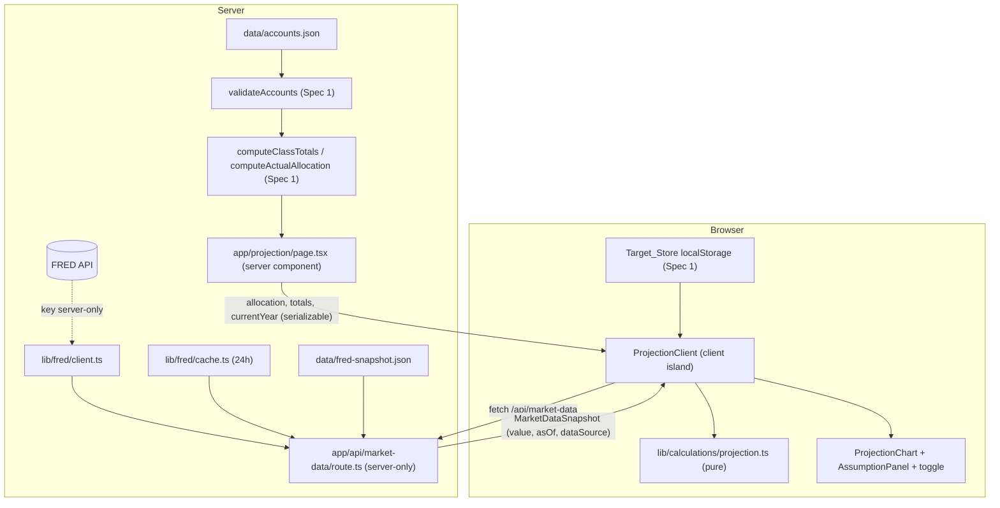
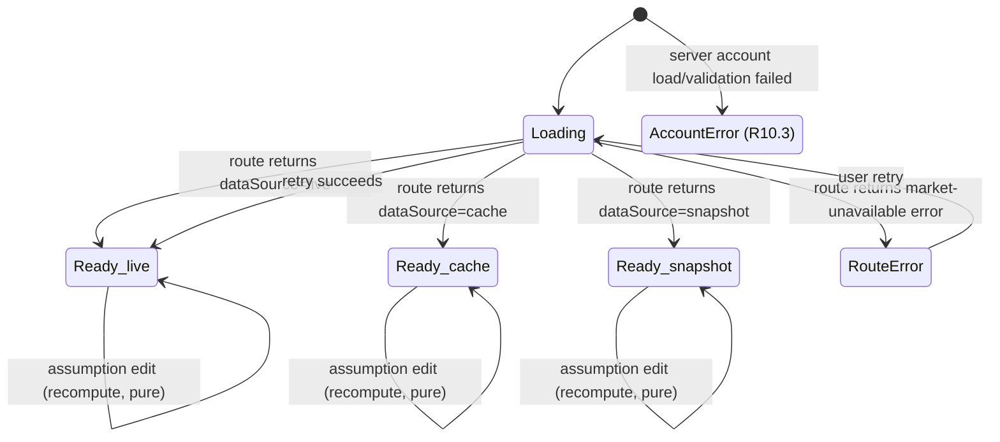

# Design Document

## Overview

The Long-Term Wealth Projection view (Spec 2) projects the user's total invested wealth forward over
10, 20, and 30 years, driven by a per-asset-class expected-return model anchored in live market data.
It reuses Spec 1's validated accounts, class totals, actual allocation, and target allocation, and adds
two new capabilities the project did not have before: a **server-only FRED market-data integration**
(fetch → 24h cache → snapshot fallback) that Spec 3 will reuse, and a **pure projection calculator**
(`lib/calculations/projection.ts`) that turns a starting value plus a return model into year-by-year
scenario series.

The design follows the Spec 1 patterns exactly:

- Pure calculators in `lib/calculations/` are inputs-in/numbers-out, import nothing from `app/`,
  `components/`, or `lib/fred/`, perform no fetch, read no `localStorage`, and never read the clock —
  the current year and all market/assumption values are passed in by the caller.
- The server component (`app/projection/page.tsx`) loads and validates static account data and resolves
  market data at the boundary, then hands serializable props to a client island that owns the editable
  assumptions, the Dollar_Basis toggle, and the target comparison.
- Formatting flows through `lib/format.ts`; all user-facing copy is centralized (a projection-specific
  message set mirroring `lib/messages.ts`); charts carry a programmatically associated text alternative
  with the SVG hidden from assistive technology.

### Requirements-to-Design Map

| Req | Summary | Where satisfied |
|---|---|---|
| R1 | Project wealth over 10/20/30 yrs, year 0 = Projected_Base, annual compounding, zero-base note, unavailable message | `projectSeries` in `projection.ts`; `ProjectionView` horizon call-outs; `projectionMessages` |
| R2 | Per-class Expected_Return from market anchors (bonds=DGS10, cash=DTB3, stocks=bonds+ERP, other=default); sources shown; snapshot fallback | `deriveReturnModel` + `computeBlendedReturn` in `projection.ts`; `AssumptionPanel` source labels |
| R3 | Every assumption visible, sourced, editable; inline validation; reset | `AssumptionPanel` (client island) + `validateAssumptions` helpers |
| R4 | Base/optimistic/pessimistic as a range; band chart; multiplier bounds; monotonic ordering | `buildScenarios` in `projection.ts`; `ProjectionChart` band |
| R5 | Nominal ↔ today's-dollars toggle; inflation unavailable fallback | `toTodaysDollars` in `projection.ts`; `DollarBasisToggle` (client island) |
| R6 | Optional fixed Annual_Contribution (0–10M), end-of-year | `projectSeries` contribution term; `AssumptionPanel` |
| R7 | Current-vs-target comparison; one-time rebalance held constant; example-target labeling; signed difference | `buildScenarios` run for target weights; `ComparisonSummary` |
| R8 | Server-only cached market route; key never exposed; 24h cache; live/cache Data_Source | `lib/fred/{client,cache,types}.ts`; `app/api/market-data/route.ts` |
| R9 | Snapshot fallback + fallback/stale signaling; as-of dates; snapshot-unreadable error | Route fallback logic; `MarketDataBanner`; `data/fred-snapshot.json` |
| R10 | Loading/error states in the view; plain language; retry; both-fail | `ProjectionView` state machine + `projectionMessages` + `ProjectionErrorBoundary` |
| R11 | Accessible chart: text alternative, hover/focus tooltip (dollars + percent), keyboard, SVG hidden | `ProjectionChart` |
| R12 | Unit tests for projection math and fallback logic only | `lib/calculations/__tests__/projection.test.ts`; route fallback tests (see Testing Strategy) |

### Steering Addition Required

`tech.md`'s FRED series table lists `MORTGAGE30US`, `CPIAUCSL`, `CUSR0000SEHA`, `CSUSHPINSA`, and
`DGS10` but **omits `DTB3`** (3-month Treasury bill), which this spec uses as the cash anchor
(R2.1). The `DTB3` row should be added to the `tech.md` FRED series table as part of implementing this
spec, so the documented series set matches the code. This is a documentation update, not a design
change.

## Architecture

### Layering and the server/client split

The projection view has two inputs that originate in different places:

1. **Account data** — the same static `data/accounts.json`, validated by Spec 1's `validateAccounts`
   and reduced to `ClassTotals` / `AllocationResult` by `computeClassTotals` / `computeActualAllocation`.
   This is target-independent and resolved on the **server** in `app/projection/page.tsx`, exactly as
   the Spec 1 dashboard does.
2. **Market data** — the three FRED series, resolved through the server-only `Market_Data_Route`
   (`app/api/market-data/route.ts`), which applies the live → cache → snapshot fallback. The FRED key
   stays on the server; the browser only ever sees a resolved `MarketDataSnapshot`.

The **target allocation** is browser-only (Spec 1's `Target_Store` reads `localStorage`), so it is read
in the client island after mount, exactly as `DashboardClient` does.

The `Projection_Calculator` is **pure** and runs wherever it is called: the server can compute a first
projection for initial paint, and the client island recomputes on every assumption edit. Because it
reads no clock and no storage, calling it in both places is safe and deterministic — the caller passes
in `currentYear` and all numeric assumptions.



Note the two independent async concerns: account data is resolved synchronously at build/render time on
the server (a module import, same as Spec 1), while the market data is fetched by the client island from
the server-only route. This keeps the FRED key off the client and lets the market-data loading/error
states live entirely in the island without blocking the page shell.

### Market-data + projection state machine

The island drives a single state for the projection area. Account data resolves on the server, so by the
time the island mounts either accounts are present or the page has already routed to the account-error
state; the island's own state machine therefore tracks the market-data lifecycle plus the derived
projection readiness.



- **Ready_live / Ready_cache / Ready_snapshot** differ only in the banner/note shown (R9.3, R9.4) and the
  Data_Source carried on each market value; the projection renders identically.
- **RouteError** is the snapshot-unreadable or route-failure case (R9.6, R10.2): no chart, no figures,
  assumptions retained, retry offered.
- **AccountError** (R10.3, R10.6) is decided on the server before the island renders; if both the account
  data and the market data fail, the account-unavailable message wins (R10.6).

## Components and Interfaces

### `lib/fred/` (server-only, imported only by `app/api/`)

**`lib/fred/types.ts`** — TypeScript types for raw FRED responses (observation shape, series id union)
and the internal cache entry shape. Re-exports nothing UI-facing.

**`lib/fred/client.ts`** — `fetchSeries(seriesId, apiKey, signal)` and
`fetchAllSeries(apiKey, timeoutMs)` performing the server-side fetch of `CPIAUCSL`, `DGS10`, and `DTB3`
from the FRED API. Reads `process.env.FRED_API_KEY` is **not** done here; the key is passed in by the
route so the client stays a thin, testable fetch wrapper. Enforces the 10-second timeout via
`AbortSignal.timeout(10_000)` (R9.2). Returns a discriminated union
`{ ok: true; values: RawSeriesValues } | { ok: false; reason: FetchFailureReason }` so the route decides
fallback — the client never throws for an expected failure (mirrors Spec 1's `ValidationResult`).

**`lib/fred/cache.ts`** — an in-memory 24-hour cache wrapper keyed by a fixed market-data key, storing the
resolved values plus a `fetchedAt` timestamp. `readCache(now)` returns the entry only when
`now - fetchedAt < 24h` (R8.4); otherwise it reports expiry so the route refetches (R8.5). `writeCache`
stores values with the fetch timestamp (R8.3). `now` is passed in so the cache module is testable without
reading the clock.

**`app/api/market-data/route.ts`** — the `Market_Data_Route`. A server-only Next.js route handler (App
Router `GET`). Orchestrates resolution and returns a `MarketDataSnapshot` as JSON. The key is read from
`process.env.FRED_API_KEY` here and never placed in any response body, header, or payload (R8.1).

Fallback decision logic, evaluated in order (R8, R9):

```
resolveMarketData(now):
  if no FRED_API_KEY configured:
      return snapshot()            # R9.1  → dataSource = snapshot
  cached = readCache(now)
  if cached is fresh (< 24h):
      return cached                # R8.4  → dataSource = cache (no FRED call)
  fetched = fetchAllSeries(key, 10s)
  if fetched.ok:
      writeCache(fetched, now)     # R8.3
      return live(fetched)         # R8.2  → dataSource = live
  else:                            # fetch failed / non-success / missing series / >10s timeout (R9.2)
      return snapshot()            #        → dataSource = snapshot
```

`snapshot()` reads `data/fred-snapshot.json`. If the snapshot cannot be read or is missing any required
series, the route returns a **market-unavailable error** response (a non-2xx with a plain-data error body
carrying no partial values) rather than any placeholder (R9.6). The fallback cascade never silently
produces a partial `MarketDataSnapshot`.

### `lib/calculations/projection.ts` (pure)

Mirrors the `allocation.ts` house style: a file-level JSDoc stating the purity contract, shared constants
(`PROJECTION_MAX_YEARS = 30`, default multipliers, default ERP, default other-return), exhaustive
iteration over `ASSET_CLASS_KEYS` reused from Spec 1, and per-function JSDoc with requirement tags.

```ts
/** Build the Return_Model from market values + editable assumptions (R2.1–R2.5). */
export function deriveReturnModel(
  market: MarketDataSnapshot,
  assumptions: ReturnAssumptions, // equityRiskPremium, otherReturn
): ReturnModel;

/** Blended base return = Σ class fraction × class Expected_Return (R2.6). */
export function computeBlendedReturn(
  allocationFractions: Record<AssetClass, number>, // 0..1 per class, sums ~1
  returnModel: ReturnModel,
): number; // percent per year

/** Project year 0..maxYears with annual compounding + end-of-year contribution (R1.1–R1.3, R6.2, R6.3). */
export function projectSeries(
  base: number,            // Projected_Base = Spec 1 total assets
  annualReturnPercent: number,
  annualContribution: number, // >= 0
  currentYear: number,     // passed in; module never reads the clock
  maxYears?: number,       // default 30
): ProjectedPoint[];       // length maxYears + 1 (years 0..maxYears)

/** Base/optimistic/pessimistic series from the blended return + multipliers (R4.1, R4.7). */
export function buildScenarios(
  base: number,
  blendedReturnPercent: number,
  multipliers: ScenarioMultipliers, // optimistic (>=1), pessimistic (<=1)
  annualContribution: number,
  currentYear: number,
  maxYears?: number,
): ScenarioSeries; // { base, optimistic, pessimistic: ProjectedPoint[] }

/** Convert a nominal series to today's dollars (R5.3). */
export function toTodaysDollars(
  series: ProjectedPoint[],
  inflationRatePercent: number,
  currentYear: number,
): ProjectedPoint[]; // value_i / (1 + infl/100)^(year_i - currentYear)
```

Key math decisions (all requirement-tagged in JSDoc):

- **Year-N recurrence (R1.3, R6.2):** `v[N] = v[N-1] * (1 + r/100) + contribution`, with
  `v[0] = base` (R1.2) and the contribution applied at end of year for N≥1; when contribution is 0 this
  reduces to pure compounding (R6.3).
- **Blended return (R2.6):** sum over the four `ASSET_CLASS_KEYS` of `fraction[class] * return[class]`.
  The fractions come from `AllocationResult.percentages` ÷ 100 (current) or `TargetAllocation` ÷ 100
  (target). The **same `ReturnModel`** is reused for both the current and target projections (R7.1).
- **Scenarios (R4.1, R4.7):** optimistic uses `blended × optimisticMultiplier`, pessimistic uses
  `blended × pessimisticMultiplier`, base uses `blended` (multiplier 1.0). Because the recurrence is
  monotonic in the rate for a non-negative base and non-negative contribution, optimistic ≥ base ≥
  pessimistic for all years whenever optimistic multiplier ≥ 1.0 and pessimistic ≤ 1.0 (R4.7).
- **Today's dollars (R5.3):** divide year `i`'s nominal value by `(1 + inflation/100)^(year_i − currentYear)`,
  so year 0 (the current year) divides by 1.
- **Target projection (R7.1, R7.2):** a one-time rebalance to `TargetAllocation` weights held constant —
  modeled simply by blending with the target fractions and projecting from the same base with the same
  scenario machinery.

This module imports only from `@/types/accounts` (for `AssetClass`), `@/types/market` (for
`MarketDataSnapshot`, `ReturnModel`), and nothing else — no `app/`, no `components/`, no `lib/fred/`.

### UI components (`components/`)

- **`components/charts/ProjectionChart.tsx`** (`'use client'`) — Recharts band chart. The band is bounded
  by the pessimistic and optimistic series (an `Area` between the two) with the base series as a line
  inside it (R4.3). It carries a programmatically associated `sr-only` text alternative listing the base,
  optimistic, and pessimistic values at years 10/20/30 with tabular numerals (R11.1), exactly like
  `AllocationPie`'s `<figure aria-labelledby>` + `<dl class="sr-only">` pattern; the SVG is `aria-hidden`
  (R11.5). Tooltips appear on **hover and keyboard focus** within 200 ms, showing the year, the dollar
  value for the focused scenario, and the percent change from the Projected_Base to one decimal (R11.2),
  and dismiss on blur/leave (R11.3). When the current-vs-target comparison is active it renders both
  bands, distinguished by a text/shape cue (e.g. a solid vs dashed base line plus a labeled legend), never
  color alone (R7.4).
- **`components/ui/AssumptionPanel.tsx`** (`'use client'`) — lists every editable assumption with its
  value, label, and source: the four class Expected_Return values, the Equity_Risk_Premium, the
  Inflation_Rate, the Optimistic_/Pessimistic_Multiplier, and the Annual_Contribution (R3.1). Market-
  derived assumptions show their `Market_Series` source label and the value's `asOf` date (R3.2); the
  stocks return shows the "bond anchor + equity risk premium" reasoning (R2.5). Inline validation messages
  appear adjacent to the offending input; invalid edits leave the last valid projection unchanged and
  retain the previously accepted value (R3.4, R3.5, R4.6, R6.5). A reset control restores defaults and
  clears messages (R3.6).
- **`components/ui/DollarBasisToggle.tsx`** (`'use client'`) — a keyboard-operable two-state control
  (nominal default / today's dollars) with a persistent text label so the basis is distinguishable
  without color (R5.1, R5.4). Switching updates values and chart in place (R5.5).
- **`components/ui/MarketDataBanner.tsx`** — reuses the Spec 1 `StaleDataBanner` idea: a `role="note"`
  banner with a text + symbol cue (never color alone) shown when `dataSource` is `snapshot` (fallback
  banner with the snapshot last-updated date, R9.3) or `cache` (plain-language "last updated" note that
  does not present the data as live, R9.4). Hidden when `dataSource` is `live`.
- **`components/ui/ComparisonSummary.tsx`** — renders the signed year-10/20/30 difference
  (target base − current base) in the active Dollar_Basis, whole-dollar tabular numerals, with a text/
  shape sign cue rather than color alone (R7.5). When the target is the Spec 1 example default
  (`isExample: true`), both the target range and the differences are labeled "based on an example target"
  (R7.6).
- **`components/ui/ProjectionEmptyState.tsx` / `ProjectionErrorState.tsx`** — plain-language empty
  (zero Projected_Base, R1.6) and unavailable (R1.7, R10) states, mirroring Spec 1's `EmptyState` /
  `ErrorState`.

### View and island

- **`app/projection/page.tsx`** (server component) — loads and validates `accounts.json` with Spec 1's
  helpers, computes `totals` and `allocation`, derives `currentYear` from `new Date()` at the boundary,
  and routes: account-load/validation failure → account-unavailable state (R10.3, R10.6); otherwise it
  renders the shell and the client island, passing serializable props (`allocation`, `totals`,
  `currentYear`). It does **not** fetch market data itself — the island does, so the FRED key path and the
  market loading/error states stay client-side against the server-only route.
- **`components/layout/ProjectionClient.tsx`** (`'use client'`, the island) — owns: fetching
  `/api/market-data`, the market/projection state machine, the editable assumptions, the Dollar_Basis
  toggle, reading the Target_Store after mount (seeding from `DEFAULT_TARGET` for SSR consistency, like
  `DashboardClient`), and calling the pure `projection.ts` functions on every change. Wrapped by a
  **`ProjectionErrorBoundary`** (same pattern as `DashboardErrorBoundary`) so an unexpected fault falls
  back to the plain-language unavailable copy.

## Data Models

### `types/market.ts` (new, shared)

```ts
/** The three FRED series this spec uses. DTB3 is new vs the tech.md table. */
export type MarketSeriesId = 'CPIAUCSL' | 'DGS10' | 'DTB3';

/** Where a served MarketDataSnapshot came from (R8.6, R9). */
export type DataSource = 'live' | 'cache' | 'snapshot';

/** One resolved market value: the number, its as-of date, and which series it is. */
export interface MarketSeriesValue {
  seriesId: MarketSeriesId;
  value: number;      // percent per year for DGS10/DTB3; index level for CPIAUCSL
  asOf: string;       // ISO date string (serializable across server→client)
}

/** The resolved set served to the view (R8.6, R9.5). */
export interface MarketDataSnapshot {
  cpi: MarketSeriesValue;    // CPIAUCSL (drives Inflation_Rate)
  tenYear: MarketSeriesValue; // DGS10 (bonds anchor)
  threeMonth: MarketSeriesValue; // DTB3 (cash anchor)
  dataSource: DataSource;
}

/** The route's error body when the snapshot is unreadable/incomplete (R9.6). Carries no values. */
export interface MarketDataError {
  ok: false;
  reason: 'market-unavailable';
}

/** Editable return assumptions not directly anchored to a series. */
export interface ReturnAssumptions {
  equityRiskPremium: number; // points added to bond anchor (default 4.0; R2.2)
  otherReturn: number;       // percent/yr (default 4.0; R2.3)
}

/** One class's resolved Expected_Return plus its display metadata (R2.4, R2.5). */
export interface ClassReturn {
  returnPercent: number;
  label: string;
  source: string; // e.g. "DGS10 (10-year Treasury), as of Oct 14, 2026"
}

/** The complete per-class return model used to blend (R2). */
export type ReturnModel = Record<AssetClass, ClassReturn>;

export interface ScenarioMultipliers {
  optimistic: number; // default 1.5, range 1.0–3.0 (R4.5)
  pessimistic: number; // default 0.5, range 0.0–1.0 (R4.5)
}

/** One projected year. */
export interface ProjectedPoint {
  year: number;   // calendar year; year offset 0 = currentYear
  value: number;  // nominal unless converted by toTodaysDollars
}

/** The three scenario series for one allocation (R4.1). */
export interface ScenarioSeries {
  base: ProjectedPoint[];
  optimistic: ProjectedPoint[];
  pessimistic: ProjectedPoint[];
}
```

### `data/fred-snapshot.json` shape

```json
{
  "cpi":        { "seriesId": "CPIAUCSL", "value": 315.6, "asOf": "2026-09-01" },
  "tenYear":    { "seriesId": "DGS10",    "value": 4.1,   "asOf": "2026-10-14" },
  "threeMonth": { "seriesId": "DTB3",     "value": 4.8,   "asOf": "2026-10-14" }
}
```

The route stamps `dataSource: "snapshot"` onto this when it serves the fallback; the file itself carries
only the three values and their as-of dates (the last-updated date shown in the fallback banner is the
most recent `asOf` among them, R9.3).

## Error Handling

All user-facing copy is plain language with no technical terms — no data-format names, no route/endpoint
names, no numeric status codes, no file names (R10.5) — and lives in a centralized
`lib/projectionMessages.ts` mirroring Spec 1's `lib/messages.ts`, so a future copy audit has a single
source.

### Market-data + projection state table (R9, R10)

| State | Trigger | What renders | Plain-language copy | Req |
|---|---|---|---|---|
| Loading | market request in flight | loading indication in place of figures + chart; no values shown | "Loading your projection…" | R10.1 |
| Ready (live) | route `dataSource=live` | full projection; no banner | — | R8.2 |
| Ready (cache) | route `dataSource=cache` | full projection + "last updated" note, not presented as live | "Market data last updated Oct 14, 2026." | R9.4 |
| Ready (snapshot fallback) | route `dataSource=snapshot` | full projection + visible fallback banner with snapshot date | "Using saved market data from Oct 14, 2026. Live data isn't available right now." | R9.3 |
| Route error | route returns market-unavailable | no figures, no chart; assumptions retained; retry offered | "We can't show your projection right now. Try again in a moment." | R9.6, R10.2, R10.4 |
| Account error | server account load/validation failed | no figures, no chart | "We couldn't load your accounts, so there's nothing to project yet." | R10.3 |
| Both fail | account data AND market data fail | account-unavailable message wins | (same as Account error) | R10.6 |
| Zero base | Projected_Base = 0 | $0 at every horizon + no-assets note | "There are no invested assets to project yet." | R1.6 |
| Inflation unavailable | today's-dollars selected but no Inflation_Rate | stay on nominal; message | "We couldn't adjust for inflation, so values are shown in future dollars." | R5.7 |

The `ProjectionErrorBoundary` catches unexpected faults and renders the same route-error copy, never a
stack trace or blank screen. Assumption inputs are preserved across a market-data error so a retry does
not discard the user's edits (R10.2, R10.4).

## Testing Strategy

Per Requirement 12, testing for this spec is limited to **example-based Vitest unit tests** for two
targets. **Property-based testing is out of scope for this spec**, and so are component tests and any
other automated tests — task planning should mark nothing beyond the two unit-test suites below. This is
why the design carries no Correctness Properties section: Requirement 12 fixes the testing scope to
example-based unit tests only. Each test asserts an exact expected numeric
value (for a calculation branch) or an exact `DataSource` / error outcome (for a fallback branch) against
a fixed input (R12.5).

### 1. Projection math — `lib/calculations/__tests__/projection.test.ts`

Covers `lib/calculations/projection.ts`:

- **Year 0 equals Projected_Base** (R12.1): `projectSeries(base, r, c, year)[0].value === base` for a
  fixed base.
- **Year-N recurrence** (R12.1): `v[N] === v[N-1] * (1 + r/100) + contribution` — assert the exact value
  at a representative year for a fixed rate and contribution.
- **Three multiplier-derived scenarios** (R12.1): base uses the blended return; optimistic uses
  `blended × optimisticMultiplier`; pessimistic uses `blended × pessimisticMultiplier` — assert the exact
  year-N value for each series from a fixed input.
- **Today's-dollars conversion** (R12.2): `toTodaysDollars` yields `nominal / (1 + infl/100)^year` —
  assert the exact value for a representative year.
- **Zero vs positive contribution** (R12.3): one fixed-input case with `annualContribution = 0` (pure
  compounding) and one with a positive contribution, asserting the exact resulting values.
- **Blended return** (supports R2.6): `computeBlendedReturn` equals the exact weighted sum for a fixed
  allocation and return model.

### 2. Market-data fallback logic — fallback resolution unit tests

Covers the live/cache/snapshot/error resolution of the `Market_Data_Route` (the pure `resolveMarketData`
decision function, tested with the FRED client and snapshot reader injected/mocked so no real network or
clock is involved):

- **No key → `snapshot`** (R12.4): with no configured key, resolution returns `dataSource = 'snapshot'`.
- **Fetch failure → `snapshot`** (R12.4): with a key configured and the fetch reporting failure
  (error / non-success / missing series / timeout), resolution returns `dataSource = 'snapshot'`.
- **Cache within 24h → `cache`** (R12.4): with a fresh cache entry, resolution returns
  `dataSource = 'cache'` and performs no FRED fetch.
- **Snapshot unreadable → error** (R12.6): when the snapshot cannot be read or is missing a required
  series, resolution returns the market-unavailable error and no partial values.
- Each assertion checks the **exact** `DataSource` or the exact error outcome for a fixed input (R12.5).

To keep the fallback resolver unit-testable without network or clock, the route delegates to a pure
`resolveMarketData({ apiKeyConfigured, readCache, fetchAllSeries, readSnapshot, now })` function whose
collaborators are injected; the thin `GET` handler wires the real collaborators. This matches the Spec 1
pattern of passing time-dependent and effectful inputs in rather than reading them inside the unit under
test.
